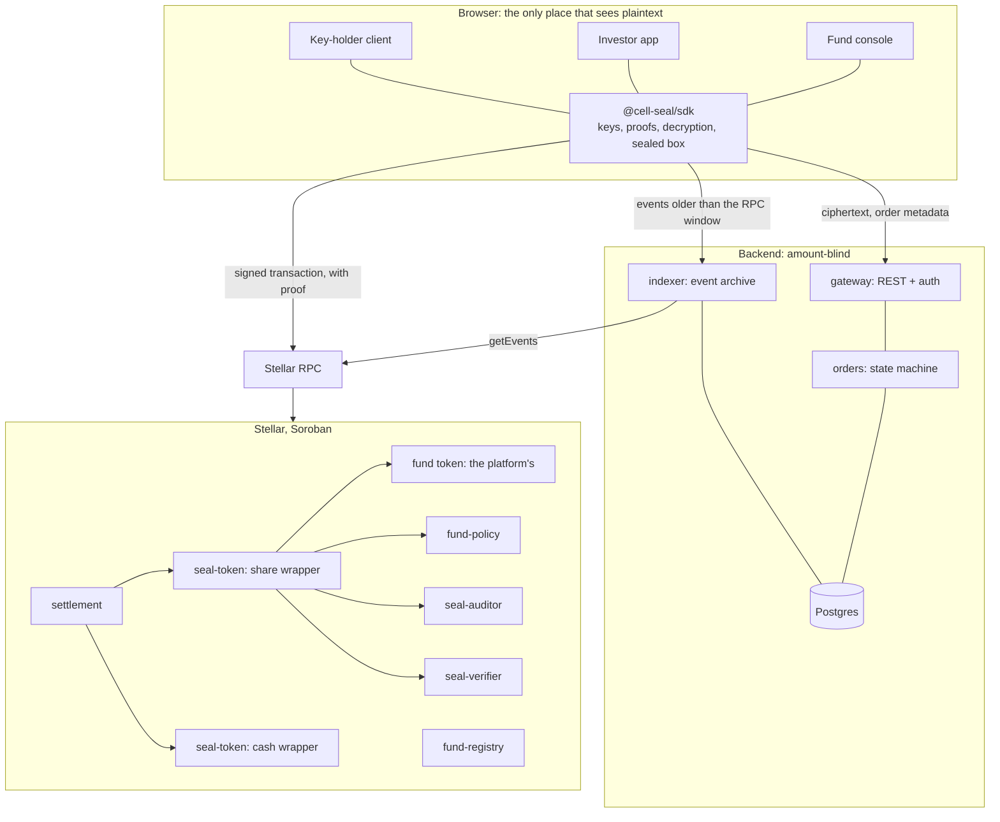
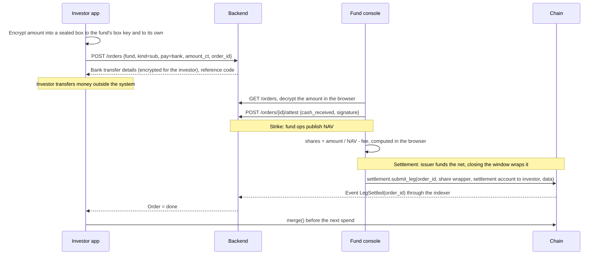

# Cell Seal: Architecture

> The root document of the technical design. Every contract, service, table and package name in
> the other documents comes from here. Read [`overview.md`](overview.md), [`glossary.md`](glossary.md)
> and [`primitives.md`](primitives.md) first.
>
> **V-n** marks something that must be checked with a prototype, **D-n** an open decision. The full
> lists are in [`open-items.md`](open-items.md) §1 and §2.

## 1. Four design principles

| # | Principle | Technical consequence |
|---|---|---|
| P1 | **Cell Seal cannot read any amount** | The backend is *amount-blind*: every amount is stored as ciphertext, encryption and decryption happen only in the browser. Proofs are built on the client |
| P2 | **The chain is the source of truth** | The status of an on-chain leg changes only when the indexer sees a final event. The database is a read model, rebuildable from the chain and from ciphertext |
| P3 | **The rail knows nothing about fund business** | Rail-layer contracts have no notion of NAV, cut-off, dealing day. Those live in the tokenization platform's system; in the sandbox, in the backend and the fund console |
| P4 | **Compose, do not rewrite** | Commitments, circuits, verifier, freeze come from OpenZeppelin's Confidential Token. Cell Seal writes only what [`primitives.md`](primitives.md) §4 and §5 list |

The product is the on-chain layer (§3.1) and the SDK (§3.3, `@cell-seal/sdk`), sold to tokenization
platforms. The backend (§3.2) and the two apps are the **sandbox**: how Cell Seal uses its own rail
for demos and for platforms to evaluate. Ownership boundary, token requirements and who mints and
burns: [`integration.md`](integration.md). The two onboarding cases: [`onboarding.md`](onboarding.md).

## 2. System diagram



## 3. Components

### 3.1 On-chain: repo `cell-seal-contracts` (Rust, Soroban)

| Contract | Instances | Role | Source |
|---|---|---|---|
| fund token | 1 per fund | The platform's SEP-41 token: SAC or Soroban token. The platform's issuer mints and burns. Cell Seal has no rights on it; `share-token` in the prototype is a sample token for tests and Case 1 | Platform. Sample: OpenZeppelin fungible |
| `seal-token` | 1 per fund (share wrapper) and 1 per stablecoin (cash wrapper) | Sealed balances and transfers; Cell Seal's hooks | OpenZeppelin `ConfidentialToken` trait, concrete contract written by Cell Seal |
| `seal-verifier` | 1 per platform | Verifies UltraHonk proofs, holds the verification key per `CircuitType` | Nethermind `rs-soroban-ultrahonk` + OpenZeppelin trait |
| `seal-auditor` | 1 per platform | Registry of viewing keys by `auditor_id`. One `auditor_id` per fund | `ConfidentialAuditor` trait |
| `fund-policy` | 1 per platform | `is_authorized(account, token)`: per-fund whitelist + KYC attestation | Cell Seal |
| `settlement` | 1 per platform | The single gate for every sealed transfer; attaches the order reference; DvP; closes the settlement window | Cell Seal |
| `fund-registry` | 1 per platform | Catalogue of funds and the public data of each | Cell Seal |

Details: [`contracts.md`](contracts.md). Requirements the fund token must meet:
[`integration.md`](integration.md) §3.

### 3.2 Backend: repo `cell-seal` (Rust workspace: axum, sqlx, tokio, Postgres), reference

A reference implementation. The platform has its own backend; what it runs from here is the
`indexer`. The rest is reference.

| Crate | Role |
|---|---|
| `gateway` | REST API, wallet-signature authentication, role-based authorization, rate limit |
| `orders` | State machine of orders and legs, dealing calendar, NAV, settlement window, attestations |
| `indexer` | Permanent archive of every event of the Cell Seal contracts; API for wallets to recover state |
| `core` | Types, configuration, Stellar RPC client, error codes |
| `auth` | Challenge, session, roles |

Details: [`backend.md`](backend.md).

### 3.3 Client: repo `cell-seal-web` (pnpm workspace: Vite, React, TypeScript, Tailwind)

| Package | Role |
|---|---|
| `@cell-seal/sdk` | Key derivation, core cryptography, proof generation in a Web Worker, wallet state, contract clients, sealed box, threshold decryption. Apache-2.0 |
| `@cell-seal/ui` | Shared design system, colour tokens from `design/` |
| `apps/fund-console` | Sandbox app: the fund's 11 screens, plus the key-holder page |
| `apps/investor-app` | Sandbox app: the investor's 7 screens |

Details: [`sdk.md`](sdk.md), [`frontend.md`](frontend.md).

## 4. Trust boundaries

| Zone | Sees | Never sees |
|---|---|---|
| **Investor's browser** | That investor's own balance and orders | Other investors' numbers |
| **Fund ops' browser** | Every order of the fund (through the fund's box key and the settlement account's key) | The k-of-n viewing key; investors' keys |
| **Key-holder client** | That party's own key share; the plaintext of the approved scope | Other parties' key shares |
| **Cell Seal backend** | Who placed an order, order type, time, status, NAV, addresses | **Every amount**, every private key, the settlement account's root |
| **Chain, observers** | Addresses, timestamps, order references, NAV, total supply, the window net | The amount of any order, the balance of any holder |

If the backend is compromised, the attacker gets metadata and ciphertext, not amounts. This is why
P1 is enforced by cryptography and not by access policy.

## 5. Data classification

| Class | Examples | Stored in | Form |
|---|---|---|---|
| **Public** | NAV, dealing calendar, total supply, net of closed windows, addresses, order references | Chain, `fund-registry`, DB | Plaintext |
| **Metadata** | Which investor an order belongs to, type, status, time, payment method | DB | Plaintext, role-scoped access |
| **Sealed on-chain** | Transfer amounts, balances | `seal-token` | Commitment + ciphertext for the recipient and for the auditor |
| **Sealed off-chain** | Amount of a fiat order, payout, net of the open window, bank details | DB | Sealed box to the box key of the fund and of the investor |
| **Secret** | Grumpkin `sk`, root, key share, private box key | Browser memory; encrypted envelope in the DB | Never leaves the client in the clear |

## 6. The accounts of a fund

| Account | Type | Used for |
|---|---|---|
| **Issuer admin** | The issuer's Stellar multisig account | Issuer of the fund token on the platform: mint, burn on the platform's rail. Admin of the share wrapper: freeze, clawback, configuration. Co-signs `close_window` |
| **Settlement account** | A Stellar account of the fund, registered in the share wrapper and the cash wrappers | Receives redemption shares, delivers subscription shares, receives and pays stablecoin, acts as spender for DvP orders |
| **Fund ops** | Personal account of each staff member | Login, signing attestations; signer of the settlement account |
| **Key holder** | Accounts of issuer, TA, regulator | Hold a share of the viewing key; approve disclosure requests |

The settlement account has several operators, so it does not use a *signer root* (a key derived
from one specific signer's signature) but a **raw root** of 32 bytes, generated when the fund is
created and handed to each fund ops member as an encrypted envelope. See [`keys.md`](keys.md) §3.

## 7. The two timelines of an order

The primitive forces the two moments apart, and every later document uses exactly these two words:

| Moment | Happens when | What takes place |
|---|---|---|
| **Strike** | Dealing day, after cut-off | NAV is published. Every pending order is *priced*. Nothing changes hands |
| **Settlement** | When the settlement window closes | The issuer has funded the public **net** into the settlement account; `close_window` wraps it, then the share legs of subscriptions are delivered and the DvP legs are executed |

Reason: before the window closes, the net shares of the period are not yet wrapped, so the
settlement account does not hold enough sealed shares to deliver every subscription. `settlement`
neither mints nor burns; the issuer does both on the platform's rail, before and after
`close_window` ([`integration.md`](integration.md) §4):

```
net = sum of subscription shares - sum of redemption shares

net > 0 :  issuer funds net public into the settlement account (mint in Case 1, transfer in Case 2)
           then close_window: deposit(net) into the wrapper                      -+
net < 0 :  close_window: withdraw(|net|) to the settlement account                -+-> sealed balance = sum of subscription shares
           then issuer burns or retires |net| on the platform's rail              |
net = 0 :  no public operation                                                    -+
                                                                                  -> deliver everything to the subscriptions -> 0
```

Redemption shares reach the settlement account at any time during the period and are the source of
the netting.

## 8. Data flow of an order

### 8.1 Subscription paid by bank transfer (DoP)



### 8.2 Redemption paid out by bank transfer (DoP)

The investor builds the proof and calls `settlement.submit_leg(order_id, share wrapper, investor to
settlement account, data)` as soon as the order is placed. The settlement account is the recipient,
so the fund console decrypts the amount with its key. After strike, fund ops make the bank transfer
and attest `cash_paid`. The shares sitting in the settlement account are netted when the window
closes.

### 8.3 DvP with stablecoin

When placing the order, the side that must pay first delegates exactly the needed part to the
settlement account with `set_spender` (cash for a subscription, shares for a redemption). At
settlement, fund ops call `settlement.settle_dvp(order_id, legs)`: the pull leg uses
`confidential_transfer_from`, the pay leg uses `confidential_transfer`, in the same invocation,
hence atomic. Only the settlement account signs; the investor need not be online. The `seal-token`
hook forces every transfer through `settlement`, so the settlement account cannot pull funds while
skipping the other leg (**V-2**). Details and limits: [`cryptography.md`](cryptography.md) §5.

### 8.4 Secondary transfer

Both investors are online. Each builds the proof for its own leg and signs one authorization entry;
one transaction calls `settlement.settle_pair(order_id, leg_a, leg_b)`. The receiving side sends
the *opening* of the leg it received to the fund (encrypted to the fund's box key) so the register
updates without the k-of-n viewing key. See [`cryptography.md`](cryptography.md) §7.

## 9. Deployment

| Environment | Stellar network | Purpose |
|---|---|---|
| `local` | Quickstart container | Development; real verifier, real proofs |
| `testnet` | Testnet | Integration and sandbox; pilot with a sample fund |
| `mainnet-pilot` | Mainnet | Capped pilot; value cap configured in `settlement` |

The backend runs under Docker Compose: `gateway`, `indexer`, `postgres`. Two deployments are
supported: hosted by Cell Seal (default) and **self-hosted by the fund**. Because the backend is
amount-blind, the two are identical in features and differ only in who holds the metadata.

Circuit artifacts (ACIR, verification key) are pinned by hash in the SDK and compared with the key
registered in `seal-verifier` at startup; on a hash mismatch the SDK refuses to build proofs.

## 10. Reading order

| # | Document | Answers |
|---|---|---|
| 0 | [`integration.md`](integration.md), [`onboarding.md`](onboarding.md) | What the platform owns, what Cell Seal provides; the two onboarding cases step by step; fund token requirements; who mints, who burns |
| 1 | [`contracts.md`](contracts.md) | Each contract: storage, functions, events, errors, authorization, invariants |
| 2 | [`cryptography.md`](cryptography.md) | What is taken from the primitive, the DvP protocol, threshold disclosure, openings |
| 3 | [`keys.md`](keys.md) | Every key: generation, storage, recovery, rotation, loss |
| 4 | [`sdk.md`](sdk.md) | The `@cell-seal/sdk` API |
| 5 | [`backend.md`](backend.md) | Services, API, data model, state machine, indexer |
| 6 | [`frontend.md`](frontend.md) | The two apps: routes, state, amount handling |
| 7 | [`security.md`](security.md) | Threat model, invariants, leak catalogue, audit plan |
| 8 | [`open-items.md`](open-items.md) | V-n, D-n, test strategy |
