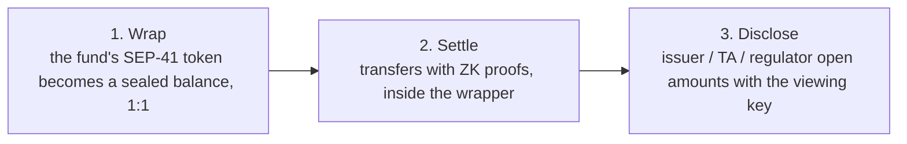

# Cell Seal: Overview

> This document answers three questions: what the product does, who it is for, and what it does
> not do. The technical design lives in the documents listed in the [`README`](../README.md).

| | |
|---|---|
| Product name | **Cell Seal** |
| Name in code and folders | `cell-seal` |
| Design | [`design/`](design/README.md): fund console and investor app (sandbox) |
| Business flows | [`flows.md`](flows.md) |
| Onboarding a fund | [`onboarding.md`](onboarding.md): Case 1 (no token yet) and Case 2 (existing token) |
| Integration with a tokenization platform | [`integration.md`](integration.md) |
| Terms | [`glossary.md`](glossary.md) |
| Primitive: what is reused, what is built | [`primitives.md`](primitives.md) |
| Technical design | start at [`architecture.md`](architecture.md) |

## 1. One sentence

Cell Seal is the settlement layer for tokenized RWA funds on Stellar. It makes the **amount** of
every transaction unreadable on the public ledger, while the issuer, the transfer agent and the
regulator can still read everything.

Cell Seal is sold to **tokenization platforms** as a contract set plus an SDK. The platform keeps
the fund token, its mint and burn rights, KYC, the order lifecycle and its own apps. A fund joins
the rail in one of two cases, [`onboarding.md`](onboarding.md):

| Where the fund is today | How it joins |
|---|---|
| New fund, no token yet; the platform creates the token together with the wrapper (Case 1) | Every share is sealed from the first transaction |
| The fund already has a token and holders on the platform (Case 2) | Wrap the existing token; holders self-wrap their balance if they want; the fund runs two rails side by side |

### What the product consists of

| Layer | Contains | Who uses it | Form |
|---|---|---|---|
| 1. Settlement contracts | Wrapper, settlement (order reference, two-leg settle, net per window), fund policy, verifier, auditor registry | Tokenization platforms on Stellar | **Product.** One contract set per platform, one wrapper per fund |
| 2. SDK and indexer | SDK for keys, proofs, decryption, sealed box, register; indexer that stores events permanently | Platforms, integrated into their own apps | **Product.** The `core` and `token` layers of the SDK are Apache-2.0 |
| 3. Sandbox: fund console and investor app | Two apps on top of the SDK, so a platform can try the rail through one full cycle | Tokenization platforms evaluating the rail | Not sold, not operated as a service for real funds |

Layers 1 and 2 are the **rail** and are what a platform buys. Layer 3 runs on that same rail so a
platform can try it before integrating; a platform that integrates layers 1 and 2 does not need
layer 3.

## 2. The problem

A holder redeems $50M from a tokenized fund on Stellar. About five seconds later the ledger
records the wallet, the amount and the time: public, permanent, impossible to switch off. The
market reads that number and reacts:

| Consequence | What happens |
|---|---|
| Front-run | Others see a $50M outflow and sell first. The fund sells assets into a worse price; the remaining holders pay for it |
| Repriced raise | The market reads the outflow as a sign of trouble. The next raise prices worse or stalls |
| Copycat run | Seeing one holder leave, others leave too, forcing the fund to sell assets in the middle of a run |

The law requires the issuer to know who its holders are, so **identity cannot be hidden and should
not be**. The amount is the one field that can be sealed without touching that obligation.

## 3. What Cell Seal does

### 3.1 What is sealed, what is not

| Field | On the ledger today | With Cell Seal |
|---|---|---|
| Holder address | Public | Public |
| Time and type of a transaction | Public | Public |
| Shares or amount of one transfer | Public | **Sealed** |
| A holder's balance | Public | **Sealed** |
| Amount wrapped in or unwrapped out | Public | Public, see 4.2 |
| NAV | Public | Public (the fund must publish it) |

Cell Seal is **confidentiality, not anonymity**. It is not a mixer and not a shielded pool: who
transacts with whom stays visible, only the number does not.

### 3.2 Three properties

| | Meaning | Who benefits |
|---|---|---|
| **Sealed** | Every amount on chain is a commitment, not a readable number | Fund and holders: the market sees that a transaction happened, not how much |
| **Proven** | Every transaction carries a ZK proof of conservation, range and policy. The chain rejects a wrong number without reading it | Everyone: nobody can print shares or spend beyond their balance |
| **Disclosed** | The viewing key is split k-of-n between issuer, transfer agent and regulator. They can rebuild 100% of the register | Compliance and audit. Cell Seal holds no key and reads no amount |

## 4. How it works

### 4.1 Three steps

1. **Wrap.** The fund token the platform already issued is wrapped 1:1. Balances become
   commitments. Assets never leave the issuer's contract; Cell Seal is non-custodial. Cell Seal
   does not mint and does not burn the fund token; that stays with the platform's issuer.
2. **Settle.** Subscription, transfer and redemption are all transfers *inside* the wrapper.
   Policy (whitelist plus on-chain KYC) is checked before every transfer. Every order has two
   legs, shares and cash, settled in one of the two modes in 4.3.
3. **Disclose.** Every transaction carries an encrypted copy for the viewing key. Authorized
   parties decrypt and rebuild the register; no Cell Seal endpoint ever returns an amount in
   plaintext.

### 4.2 The wrapper boundary is public

Wrapping in and unwrapping out **still reveal the amount**. This is a limit of the primitive and
has to be stated plainly. Therefore:

- A redemption is **not** done by the holder unwrapping. The holder transfers shares to the
  issuer's account *inside* the wrapper, where the number is sealed.
- The issuer unwraps later, on a fixed **settlement window** (weekly, for example), decoupled
  from the time of any individual redemption.

What the market sees is the **net total of the whole window**, not individual orders. A fund with
few orders needs a longer and more regular window so that the net cannot be traced back to one
order; this parameter is configured per fund.

### 4.3 Two settlement modes

Funds price forward: at order time there is no NAV yet, so request and settlement are always one
period apart. An order therefore has two legs with separate states, and the mode only decides how
tightly the two legs are bound.

| | **DoP**, two legs apart | **DvP**, atomic |
|---|---|---|
| How it runs | One leg goes first; the other is delivered once the first is confirmed | Both legs in one transaction, all or nothing. Each side decrypts and checks the other side's amount before signing |
| Cash leg | Fiat through a ramp (issuer attests), or sealed stablecoin | On-chain stablecoin, wrapped and sealed |
| Counterparty risk | The side that delivers first trusts the other | None |
| Used for | Subscription and redemption with the issuer, the default | Secondary transfers between two holders; sub/red when the cash leg is a stablecoin |
| What is new | Nothing: each leg is an existing sealed transfer | The settlement contract. A circuit linking the two amounts is only needed if the chain itself must enforce the price relation, [`primitives.md`](primitives.md) §5.1 |

DoP is the base: it matches how funds already operate and runs on the primitive as is. DvP is
built on the same order model, for transactions where the two sides have no reason to trust each
other.

One rule for both modes: **the on-chain cash leg is never a public stablecoin.** NAV is public, so
a readable payout divided by NAV gives the number of shares.

### 4.4 Cell Seal is a rail, not a fund platform

The order lifecycle (request, cut-off, NAV strike, approval, reconciliation) belongs to the fund
management system the issuer already uses. Cell Seal owns settlement and disclosure only. A
platform integrates at four points:

| Integration point | Change on the platform side |
|---|---|
| Order | Orders carry no plaintext amount. The holder transfers sealed shares with an order reference; the platform emits no event that contains an amount |
| Register | Balances are no longer read from the token (the only visible holder is the wrapper). The platform rebuilds the register from data decrypted with the viewing key |
| Settlement | The platform computes payouts from NAV as before, then triggers the remaining leg (DoP) or calls the settlement contract (DvP). At the end of the window: fund the public net into the settlement account, call `close_window` |
| Supply | The issuer still mints and burns through the platform's own rail. `settlement` only wraps and unwraps the net, [`integration.md`](integration.md) §4 |

The fund console and the investor app are a **sandbox**, not the product: two apps on the SDK that
let a tokenization platform try the rail, run one full cycle, and see how the points above plug in.
They are not operated as a service for real funds. The fund console can create a fund with a sample
token, add investors, receive orders, set NAV, pay out, settle, rebuild the register and grant audit
access. The investor app can browse funds, invest, redeem and follow a portfolio. The investor's
privacy key is derived from a signature of their own wallet, and the proof for every order is
built in the browser, so Cell Seal reads no amount even in the demo.

Two decisions for the first version: fiat is **confirmed manually** by fund ops (money received,
money paid), with no bank or ramp integration yet; stablecoins settle on chain.

Design: [`design/README.md`](design/README.md), fund console 11 screens, investor app 7 screens,
source file [`design/cell-seal.pen`](design/cell-seal.pen).

## 5. Who it is for

| Role | Who | Relation to Cell Seal |
|---|---|---|
| Buyer | Tokenization platform | Pays for the contracts and the SDK; integrates them into its apps |
| Issuer | The fund's issuer on the platform, or a transfer agent acting for it | Holds the fund token, mints and burns; co-signs `close_window`. A customer of the platform |
| Admin user | Fund ops / TA operations | Day-to-day operation in the platform's app: whitelist, order queue, register |
| End user | A KYC'd investor of the fund | Uses the platform's app: browse, subscribe, redeem, portfolio. Holds their own privacy key. Pays nothing to Cell Seal |
| Oversight | Compliance, auditor, regulator | Reads through the viewing key |

First customer: **a tokenization platform on Stellar with at least one NAV-priced open-ended fund,
an issued SEP-41 token, and redemptions large enough to move the price.** This is the one asset
class that meets all three conditions that make a revealed size truly harmful: large relative to
AUM, a public price to trade against, and redemptions frequent enough to form a pattern.

## 6. What Cell Seal builds, what it reuses

The cryptographic base already exists on Stellar; Cell Seal does not rewrite it.

| Reused | Status |
|---|---|
| Confidential Token (wrapper, sealed balances and transfers, auditor key, verifier) | Developer preview on testnet, not yet audited |
| BN254 and Poseidon host functions (Protocol 25) | Mainnet |
| On-chain KYC attestation | Available |

| Cell Seal builds | Why it is needed |
|---|---|
| Two-leg order model, DoP mode | Base for every sub/red; runs on the existing sealed transfer |
| Confidential DvP: two legs, two tokens, atomic | The primitive only has a one-way, one-token transfer. The first version is a settlement contract, no new circuit |
| Settlement window | The answer to 4.2 |
| Integration interface: order reference, register API, settlement hook | So an existing fund platform can plug in without changing its order lifecycle (4.4) |
| Fund policy: whitelist plus KYC | The primitive gives the interface only, not an implementation |
| k-of-n disclosure | The primitive has a single auditor key |
| Position limit | The policy call cannot see amounts. First version checks at order intake with numbers the issuer can already read; an on-chain circuit comes later |
| Clawback | First version uses the primitive's clawback (public amount, account must be frozen). Sealed forced transfer comes later |
| Indexer, register reconstruction in the SDK | What a platform actually runs |
| Sandbox: fund console and investor app | So a platform can try the rail before integrating; not sold |

Mainnet go-live depends on the Confidential Token reaching mainnet. Everything Cell Seal builds
itself can be done before that, on testnet.

## 7. Not in scope

- Not a tokenization platform. The fund console is a sandbox only; no fund accounting, no
  reporting, no standalone investor portal
- No mint, no burn of the fund token; no issuance rights taken from the issuer
- No on/off ramp, no custody, no KYC provider; existing providers are integrated
- No exchange, no matching engine
- No multi-chain
- No hiding of holder identity
- No rewrite of the confidential token primitive
