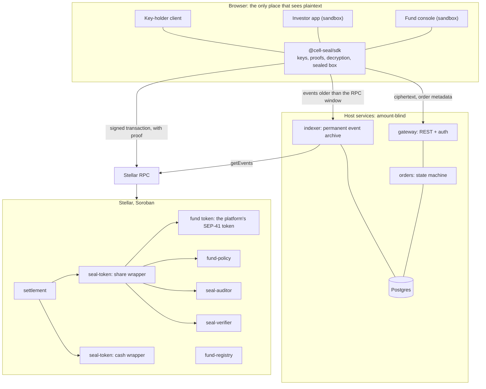
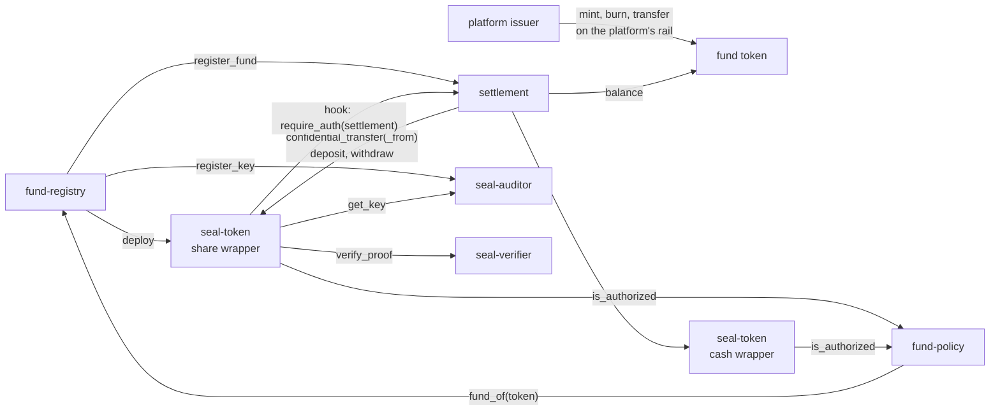
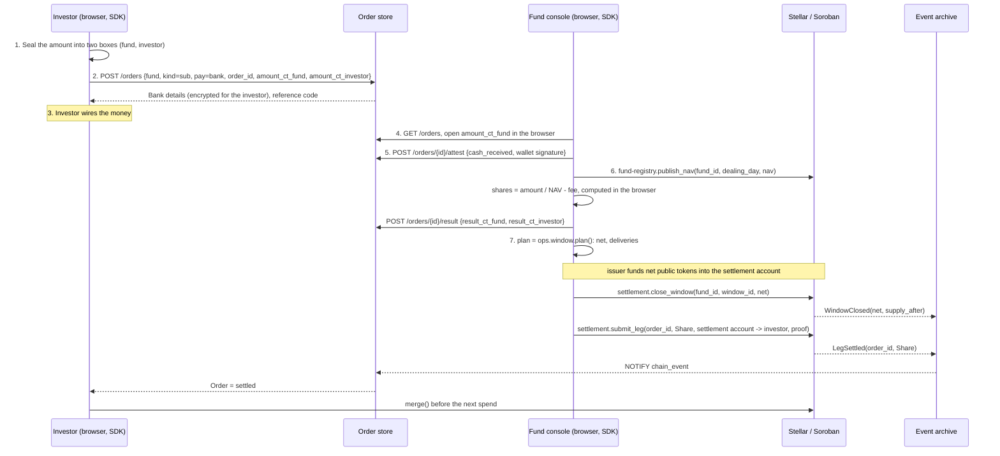

# Cell Seal Technical Architecture

| | |
|---|---|
| Document | Technical Architecture Document |
| Project | Cell Seal, confidential settlement for tokenized fund shares on Stellar |
| Version | 1.0 |
| Date | 2026-11-09 |
| Status | Architecture complete. Implementation of the contracts has started on testnet |
| Programme | Stellar Community Fund, Build Award |
| Design repository | `SentinelLab-VN/Cell-Seal-TDD` |
| Prototype repository | `SentinelLab-VN/cell-seal-mvp` |

## 1. Introduction

### 1.1 Purpose and scope

This document describes the architecture of Cell Seal: its components, the Soroban contracts
and how they interact, the flow of data through the system, the security model, the
infrastructure it runs on, and the state of the implementation. It is the entry point to the
technical design. Each section ends with a reference to the design document that holds the full
detail; section 10 lists them all.

Roadmap, deliverables and budget are part of the application form and are not repeated here.

### 1.2 Background

Tokenized funds settle on Stellar in a few seconds, and every settlement is public: the ledger
records the wallet, the amount and the time, permanently. For an open-ended fund this creates a
problem that does not exist in traditional fund administration. A large redemption is visible
to the whole market before the fund has sold the underlying assets, so the fund sells into a
worse price and the remaining holders pay for it. A pattern of outflows is read as a signal and
reprices the next raise. One visible exit triggers others.

Regulation requires the issuer to know every holder, so the identity of the parties cannot be
hidden and should not be. The amount is the one field that can be made confidential without
affecting that obligation. Cell Seal makes it confidential.

### 1.3 Product summary

Cell Seal is a settlement layer that a tokenization platform on Stellar integrates into its
existing fund product. It is delivered as a set of Soroban contracts and a TypeScript SDK, with
an onboarding procedure for bringing a fund onto it. The platform keeps its fund token, its mint
and burn rights, its KYC process, its order lifecycle and its own applications.

Once a fund is on Cell Seal, the amount of every transfer and the balance of every holder is
recorded on the ledger as a cryptographic commitment accompanied by a zero-knowledge proof.
Addresses, timestamps and order references remain public. The issuer, the transfer agent and the
regulator hold a k-of-n viewing key that lets them read every amount and rebuild the full share
register. Cell Seal, the company, holds no key and can read no amount.

A fund joins in one of two situations. A new fund with no token yet has its token and its
confidential wrapper created together, and no balance is ever public (Case 1). A fund that
already has a token with public holders wraps the existing token, and holders move into the
confidential layer when they choose to (Case 2). Both use the same contracts.

The product also ships with a sandbox: a reference tokenization platform with Cell Seal
integrated, consisting of an order backend, a fund console and an investor application. It
exists so that a platform can run a full subscription and redemption cycle before integrating,
and so that integrators have a worked example to read. It is not sold and is not operated for
real funds.

### 1.4 Design principles

Four principles decide every design question in the documents that follow.

1. **Cell Seal cannot read any amount.** Encryption, decryption and proof generation happen only
   in the browser of an authorised party. Every amount leaves the browser as ciphertext. Any
   backend the SDK communicates with is blind to amounts by construction, not by access policy.
2. **The chain is the source of truth.** The state of an on-chain operation changes only when a
   final ledger event has been observed. Every database in the system is a read model that can
   be rebuilt from the chain and from stored ciphertext.
3. **The settlement layer knows nothing about fund business.** The contracts have no concept of
   NAV, cut-off or dealing day. Those belong to the platform.
4. **Compose, do not rewrite.** The cryptographic primitive, OpenZeppelin's Confidential Token
   for Stellar, is used unmodified. Cell Seal builds only what the primitive does not provide.

### 1.5 Terminology

The glossary ([`glossary.md`](glossary.md)) defines every term. The ones needed to read this
document:

- **Wrapper**: a `seal-token` contract holding a SEP-41 token 1:1 and issuing sealed balances
  against it. A *share wrapper* holds a fund token, a *cash wrapper* holds a stablecoin.
- **Sealed**: recorded on the ledger as a Pedersen commitment with an encrypted copy for the
  recipient and for the auditor, never as a readable number.
- **Order**: a subscription, redemption or secondary transfer. Every order has a *share leg* and
  a *cash leg*, and is identified on chain only by an `order_id`.
- **Strike**: the moment the NAV for a dealing day is published and pending orders are priced.
- **Settlement window**: the fixed period at whose end the net of all orders moves between the
  public token and the wrapper. The window's *net* is the only amount that becomes public.
- **Settlement account**: the fund's account inside the wrapper that delivers and receives shares
  and acts as counterparty to every order.
- **Viewing key**: the auditor key of the primitive, held in k-of-n shares by the issuer, the
  transfer agent and the regulator.

## 2. System architecture

### 2.1 Context

The system has three tiers. The **client tier** is the user's browser running the platform's
application with the SDK embedded. It is the only tier that holds private keys or sees an amount
in plaintext. The **chain tier** is the set of Soroban contracts, deployed once per platform,
plus one wrapper per fund. The **host services tier** is the infrastructure the SDK needs around
the chain: a Stellar RPC endpoint, a permanent archive of contract events, and a store for order
metadata and ciphertext. The platform provides these in its own infrastructure. The sandbox
backend is one implementation of them.

### 2.2 Components

**`@cell-seal/sdk`.** A TypeScript package that the platform embeds in its applications. It
derives the user's privacy key from a wallet signature, builds zero-knowledge proofs in a Web
Worker using bb.js, encrypts and decrypts amounts, maintains the wallet's view of its sealed
balance by replaying ledger events, and wraps every contract call. Private keys never leave the
worker; the main thread of the page receives decrypted amounts for display and opaque handles for
everything else. The SDK is the only code in the system that touches a private key or a
plaintext amount.

**Soroban contracts.** Seven contract types, described in section 3. Five are deployed once per
platform (`settlement`, `fund-policy`, `seal-verifier`, `seal-auditor`, `fund-registry`). The
`seal-token` wrapper is deployed once per fund and once per accepted stablecoin. The fund token
belongs to the platform and is not a Cell Seal contract.

**Event archive.** Stellar RPC retains events for a limited window, and a wallet that has lost
its local state can only rebuild its sealed balance by replaying every event that concerns it.
The archive stores every event of every Cell Seal contract permanently, in global order, together
with the invocation arguments of calls into `settlement`. The sandbox `indexer` crate is the
reference implementation and a platform may run it as is.

**Order store.** Holds order metadata (who, what kind, when, which status), the sealed boxes that
carry off-chain amounts, signed attestations from fund operations staff, key envelopes and the
messages of the viewing-key ceremony. It holds no key and no plaintext amount. The sandbox
`gateway` and `orders` crates implement it; a platform maps the same operations onto its own
order system.

**Sandbox applications.** A fund console (eleven screens: fund setup, investors, orders, NAV,
settlement, register, audit access) and an investor application (seven screens: account setup,
fund list, invest, redeem, orders, portfolio), both built on the SDK. They demonstrate the
integration points a platform must implement in its own applications.

### 2.3 Trust boundaries and data classification

| Zone | Can see | Cannot see |
|---|---|---|
| Investor's browser | Own balance and own orders | Other investors' amounts |
| Fund operations' browser | Every order of the fund, through the fund's keys | The k-of-n viewing key. Investors' private keys |
| Key-holder client | Own key share. Plaintext of an approved disclosure scope | Other parties' shares |
| Host services | Who placed an order, its type, time and status; NAV; addresses | Any amount. Any private key |
| Ledger and public observers | Addresses, timestamps, order references, NAV, sealed supply, each window's net | Any order amount. Any holder balance |

Data falls into five classes. **Public** data (NAV, dealing calendar, total supply, window nets,
addresses, order references) is stored in plaintext on chain and in the order store.
**Metadata** (which investor placed which order, type, status, payment method) is stored in
plaintext in the order store with role-based access. **Sealed on-chain** data (transfer amounts,
balances) exists only as commitments and ciphertext in the wrapper. **Sealed off-chain** data
(amount of a fiat order, payout, bank details) exists only as sealed boxes in the order store,
readable by the fund and the investor. **Secrets** (privacy keys, roots, key shares, box keys)
exist only in browser memory and, for backup, as encrypted envelopes that the backend cannot
open.

If the host services are fully compromised, the attacker obtains metadata and ciphertext. This
is the reason principle 1 is enforced by cryptography rather than by access control.

Full component design: [`architecture.md`](architecture.md). Product boundary and what the
platform owns: [`integration.md`](integration.md).

## 3. Stellar and Soroban integration

### 3.1 Why Stellar

Cell Seal depends on four properties of Stellar and would not work on a chain without them.

Protocol 25 added BN254 and Poseidon host functions to Soroban. These make it possible to verify
an UltraHonk zero-knowledge proof on chain within the per-transaction instruction limit: one
proof costs 90 to 97 million instructions against a ceiling of 400 million, measured on testnet.
Two proofs fit in a single transaction, which is what an atomic delivery-versus-payment needs.

OpenZeppelin's Confidential Token module for Soroban provides the cryptographic primitive:
Pedersen commitments on the Grumpkin curve, six Noir circuits, encryption of every amount for the
recipient and for an auditor, freeze, and a policy hook. Cell Seal composes this primitive rather
than building a confidential token from scratch.

Soroban contract invocations are atomic across nested calls. A single call into `settlement` that
performs two confidential transfers either completes both or neither. This gives Cell Seal an
atomic DvP without a new circuit.

Tokenized funds already exist on Stellar as SEP-41 tokens, whether classic assets through their
Stellar Asset Contract or Soroban tokens. The wrapper holds any such token 1:1 without modifying
it, so a platform does not reissue its fund.

Two further properties simplify the design. SEP-0053 message signing with ed25519 lets the
privacy key be derived deterministically from the user's wallet, so there is no separate seed
phrase. A Stellar ledger is final when it closes, so state can advance on the first observation
of an event.

### 3.2 Contract set

| Contract | Deployed | Role | Origin |
|---|---|---|---|
| Fund token | Per fund, by the platform | The fund's SEP-41 token. The issuer mints and burns it on the platform's own rail | Platform |
| `seal-token` | Per fund (share wrapper) and per stablecoin (cash wrapper) | Holds the token 1:1 and maintains sealed balances. Implements the OpenZeppelin `ConfidentialToken`, `ConfidentialCompliance` and `ConfidentialClawback` traits. `SealHooks` add Cell Seal's rules | OpenZeppelin traits, Cell Seal contract |
| `seal-verifier` | Per platform | Verifies UltraHonk proofs against one verification key per circuit type. Key updates pass through a timelock | Nethermind verifier, OpenZeppelin trait |
| `seal-auditor` | Per platform | Registry of viewing keys by `auditor_id`, one per fund | OpenZeppelin trait |
| `fund-policy` | Per platform | Answers `is_authorized(account, token)` from a per-fund whitelist with KYC expiry. Receives an address and a token, never an amount | Cell Seal |
| `settlement` | Per platform | The only path for a sealed transfer. Binds each transfer to an `order_id`, executes DvP atomically, closes the settlement window by exactly `net`. Neither mints nor burns | Cell Seal |
| `fund-registry` | Per platform | Public catalogue of funds: terms, NAV per dealing day, roles. Deploys the wrapper when a fund is created | Cell Seal |

The code lives in the `cell-seal-contracts` workspace (today under `cell-seal-mvp/contracts`),
written in Rust against the Soroban SDK, one crate per contract. OpenZeppelin code is pinned to
commit `5ffda91` of the `v0.9.0` branch of `stellar-contracts`.

### 3.3 Contract interfaces

**`seal-token`** exposes the primitive's interface unchanged: `register`, `deposit`, `withdraw`,
`merge`, `confidential_transfer`, `confidential_transfer_from`, `set_spender`,
`revoke_spender`, plus `freeze`, `unfreeze` and `clawback` for the compliance operator. Cell
Seal's constructor adds a `SealConfig` naming the `settlement` contract, the `fund-registry`, the
wrapper kind and, for a share wrapper, the fund id. The primitive offers one extension point, a
`Hooks` trait invoked after authentication and payload decryption and before storage is written.
`SealHooks` uses it to enforce five rules:

- `on_register`: the account's `auditor_id` must be the fund's. Otherwise an investor could
  register with an auditor the fund cannot read.
- `on_deposit`: `from` must equal `to`, and `to` must pass the policy. A deposit has a public
  amount, so nobody may deposit on another account's behalf.
- `on_withdraw` (share wrapper): only the settlement account, and only when called by
  `settlement`. Investors never unwrap shares; shares leave the wrapper only as a window's net.
- `on_transfer`, `on_spender_transfer`: `settlement.require_auth()` must succeed, so every sealed
  transfer carries an order reference and no allowance can be pulled outside a DvP.
- `on_set_spender`: the spender must be a settlement account.

A hook never receives the amount of the operation it is validating.

**`settlement`** has six entry points. `register_fund` is called by `fund-registry` when a fund is
created. `submit_leg(fund_id, order_id, role, leg)` executes one sealed transfer in which one end
is the settlement account, and records that `(order_id, role)` has settled. `settle_dvp(fund_id,
order_id, pull, pay)` executes a `confidential_transfer_from` against an investor's allowance and
a `confidential_transfer` back to the investor in one invocation, signed by the settlement
account only. `settle_pair(fund_id, order_id, a, b)` executes two transfers between two investors
in different tokens, each signing one authorization entry. `close_window(fund_id, window_id, net,
withdraw_data)` refuses to run before the window's scheduled close, checks that the settlement
account holds exactly the public tokens needed when `net > 0`, moves `net` between the settlement
account and the wrapper, enforces the pilot cap, and emits `WindowClosed(net, supply_after)`. It
requires the signatures of both the issuer admin and the settlement account. `set_pilot_cap` is
reserved to the platform admin.

**`fund-policy`** implements `is_authorized(account, token) -> bool`, called by the wrapper for
both ends of every operation. An account is authorised on a share wrapper if it is the fund's
settlement account or an `Approved` investor of that fund whose `kyc_expiry` has not passed. On a
cash wrapper, if it is a settlement account of any fund or an approved investor of at least one
fund. `set_investor` requires the `Compliance` role of the fund, granted by the issuer admin
through `fund-registry`.

**`fund-registry`** creates a fund in one invocation: it deploys the share wrapper through the
Soroban deployer from the pinned wasm hash, registers the fund's viewing key in `seal-auditor`,
opens the first settlement window in `settlement`, stores the fund's public record and grants the
issuer admin every fund role. It also holds `publish_nav(fund_id, dealing_day, nav)`, one NAV per
dealing day under the `NavPublisher` role, so that investors read the price from the chain and
every price has a ledger anchor.

**`seal-verifier`** and **`seal-auditor`** are the primitive's traits with access control:
verification keys are written by the platform admin, and an update is two calls separated by
`timelock_ledgers` (default 17,280 ledgers, about 24 hours). Auditor keys are registered by
`fund-registry` and rotated by the fund's issuer admin.

Full signatures, storage layouts, events, error codes (4000 to 4505) and the permission matrix are
in [`contracts.md`](contracts.md).

### 3.4 Interaction between contracts

A sealed transfer always enters through `settlement`, which calls the wrapper. The wrapper
verifies the proof through `seal-verifier`, checks both parties through `fund-policy`, reads the
fund's viewing key from `seal-auditor` to validate the auditor ciphertext, and runs `SealHooks`,
which confirms that the caller is `settlement`. The wrapper calls the fund token only inside
`deposit` and `withdraw`, to move public tokens into and out of its pool. `settlement` reads the
fund token's `balance` to check that the issuer has funded a window before wrapping it.

The call `settlement.require_auth()` inside a wrapper hook succeeds only when `settlement` is the
contract invoking the wrapper. A direct call to the wrapper fails even when the sender has
signed. This was confirmed on testnet.

### 3.5 On-chain and off-chain state

| Data | On chain | Off chain | Reason |
|---|---|---|---|
| Transfer amounts and balances | Commitment plus ciphertext for recipient and auditor, in the wrapper | The opening `(value, blinding)` in the holder's wallet, encrypted in IndexedDB | The chain verifies conservation without reading the number; the holder needs the opening to spend |
| Order reference | `order_id = SHA-256(fund_id ‖ investor ‖ nonce)` in `settlement` events | Joined to metadata in the order store | The one element of an order that is public |
| Amount of a fiat order, payout, bank details | Never | Sealed box to the fund's and the investor's box keys | Fund operations must read it; the backend must not |
| NAV, fund terms, roles | `fund-registry` | Cached | Public by nature; investors read the price from the chain |
| Window net and sealed supply | `WindowClosed` event | Cached | The one aggregate figure per window that is public by design |
| Investor status and KYC expiry | `fund-policy` | The platform's KYC system | The wrapper must check policy without depending on a backend |
| Order status and ownership | No | Order store | Business metadata the settlement layer does not need |
| Event history | RPC retains about 7 days | Permanent archive | Wallets recover by replaying events |
| Private keys, roots, key shares | Never | Browser memory; encrypted envelopes for backup | Principle 1 |

### 3.6 Standards, assets and accounts

Cell Seal uses SEP-41 for the fund token and the stablecoin, and SEP-0053 for the wallet
signatures from which the privacy key and the box key are derived. The signed message names the
wrapper and the account, so a signature obtained by deception unlocks nothing else. The SDK
requests the signature twice and compares the results; a wallet that signs non-deterministically
(MPC or threshold wallets) is given a random root with a mandatory backup step instead.

Fund tokens with `AUTH_REQUIRED` are supported: the issuer authorises the wrapper and the
settlement account before the first deposit. `AUTH_CLAWBACK_ENABLED` requires a written
commitment from the issuer not to claw back the wrapper's pool, because that pool backs every
sealed balance. SEP-8 regulated assets are not supported in the sealed layer, because a transfer
invoked by a contract does not pass through the SEP-8 approval server.

The system is non-custodial. The wrapper holds the pooled token; investors hold their own Stellar
key and privacy key; Cell Seal holds nothing. A fund operates four kinds of account: the issuer
admin (a multisig that co-signs every window close), the settlement account (a fund account whose
signers are operations staff), personal accounts of operations staff, and the key holders'
accounts. The platform admin is a 2-of-3 multisig on hardware wallets, and every upgrade or
verification-key change it makes passes through the on-chain timelock.

The settlement account has several operators who change over time, so its privacy key is not
derived from a signer. It is derived from a 32-byte `ops_root` generated when the fund is created
and distributed to authorised staff as encrypted envelopes. Spending from the settlement account
needs both a proof (which needs `ops_root`) and the account's signature (which needs signer
weight), so exposure of either alone does not move assets.

### 3.7 Resource usage

Measured on testnet (protocol 29) on 2026-10-09, with real UltraHonk proofs and the Nethermind
verifier:

| Operation | Proof | Instructions | Resource fee | Footprint (read / write) |
|---|---|---|---|---|
| `register` | register | 89,087,248 | 0.095 XLM | 11 / 1 |
| `close_window`, `net > 0` | none | 17,770,000 | 0.403 XLM (mostly rent for new entries) | |
| `submit_leg` via `settlement` | transfer | 93,905,795 | 0.165 XLM | 17 / 3 |
| `close_window`, `net < 0` | withdraw | 96,637,602 | 0.129 XLM | 18 / 6 |
| `settle_dvp`, `settle_pair` | two transfers | about 188,000,000 | | |

The transaction limit is 400,000,000 instructions. A proof is 14,592 bytes for every circuit.
Proving takes about one second on a laptop and 2.7 to 6.7 seconds on a 4 GB phone with
multithreading. Amounts are `i128` with seven decimals; NAV is `i128` at scale 10^7.

### 3.8 Storage, TTL and upgrades

Sealed accounts, spender delegations, fund records, window state, policy entries and the
`Settled(order_id, role)` replay guard are persistent storage. A host job extends their TTL
daily for every account active in the last ninety days; the platform pays the fee and prices it
into its service. An expired entry can be restored at the restore fee and nothing is lost.
Verification keys are instance storage and are bumped with the contract.

`settlement`, `fund-policy` and `fund-registry` are upgraded by the platform admin behind the
timelock. A fund's wrapper is upgraded by that fund's issuer admin. Because the wrapper address
is an input to every holder's key derivation, a wrapper is always upgraded in place and never
redeployed.

Primitive survey and measurements: [`primitives.md`](primitives.md). Cryptographic design:
[`cryptography.md`](cryptography.md).

## 4. Data flow

### 4.1 Order model

Every subscription, redemption and secondary transfer is an order with two legs. The share leg is
always on chain, inside the share wrapper, sealed. The cash leg is either off chain (a bank
transfer, confirmed by a signed attestation from fund operations) or on chain inside a cash
wrapper, sealed. Each leg has its own state and the order is complete when both are confirmed.

Funds price forward: an order is placed before the price is known. Three moments are therefore
kept apart. At **placement** the order is recorded and, where applicable, the investor's sealed
funds are escrowed. At **strike** the NAV is published on chain and every pending order is priced
in the fund's browser. At **settlement**, when the window closes, the issuer funds the window's
net, `close_window` wraps it, and shares are delivered.

Two settlement modes exist. In **DoP** (delivery or payment) the two legs are settled separately
and the second waits for the first to be confirmed; this is the default for subscriptions and
redemptions against the issuer. In **DvP** both legs settle in one atomic transaction; this is
mandatory for secondary transfers and available for orders paid in stablecoin.

### 4.2 Subscription paid by bank transfer

1. **Placement.** The investor enters the amount. The SDK builds an `OrderSecret` containing the
   amount, currency and `order_id`, pads every numeric field to a fixed length, and seals it twice
   with libsodium `crypto_box_seal`: once to the fund's box key and once to the investor's own.
   It posts the metadata and both ciphertexts to the order store. Nothing reaches the chain.
2. **Payment.** The order store returns the fund's bank details, encrypted for the investor, and
   a reference code that contains only the order code. The investor wires the money outside the
   system.
3. **Confirmation.** Fund operations open the fund's copy of the ciphertext in the browser,
   match the incoming payment, and sign an attestation `{order_id, cash_received, time}` with
   their wallet. The order store verifies the signature and the signer's on-chain role and
   stores the attestation verbatim. The cash leg is now confirmed.
4. **Strike.** On the dealing day, fund operations publish the NAV through `fund-registry`. The
   SDK computes `shares = amount / NAV − fee` for every priced order, in integers with a single
   rounding rule, seals the result to the fund and to the investor, and posts both ciphertexts.
5. **Settlement.** When the window is due, `ops.window.plan()` returns the net of all orders.
   The issuer mints (Case 1) or transfers (Case 2) exactly `net` public tokens into the settlement
   account. The SDK checks that the account's public balance equals `net`, then calls
   `close_window`, which deposits `net` into the wrapper and emits `WindowClosed`. The SDK then
   calls `submit_leg` once per subscription, each with a freshly built proof, delivering sealed
   shares from the settlement account to the investor.
6. **Completion.** The archive records `LegSettled(order_id, Share)` and notifies the order
   store, which marks the share leg confirmed and the order settled. The investor's SDK observes
   the transfer, decrypts the amount with the viewing key, and calls `merge` before the next
   spend.

What the ledger shows for this order: a NAV, one public funding of `net` into the settlement
account, one `deposit` of `net`, and one sealed transfer from the settlement account to the
investor's address. It never shows how much the investor subscribed.

### 4.3 Failure handling

| Failure | Detection | Resolution |
|---|---|---|
| Payment never arrives | The order remains in `awaiting_cash`; the age of the oldest such order is a monitored metric | Fund operations hold, reject or cancel. No share has moved |
| Forged attestation | The order store verifies the wallet signature and the `fund_ops:signer` role, whose source of truth is on chain | Rejected at write time. A compromised backend cannot produce one |
| Window closed too early, or not funded | `close_window` reverts with `WindowNotDue` or `NetNotFunded`. The SDK refuses earlier with `E_WINDOW_NOT_DUE`, `E_NET_NOT_FUNDED` or `E_NET_OVERFUNDED` | The issuer funds exactly `net` and retries. A surplus is refused because it reveals the next period |
| A delivery transaction fails during a window | Each proof depends on the previous one through the settlement account's commitment, so the SDK stops, resyncs and regenerates the remaining proofs | `Settled(order_id, role)` prevents a retry from delivering twice |
| Client claims a transaction succeeded | No API changes on-chain leg state; only an archived event does | The UI shows the order as confirming until the archive has the event |
| Archive falls behind RPC retention | Alert when the gap reaches 25% of the retention window | Backfill from Horizon or an archive node. New orders with an on-chain leg are paused |
| Wallet state diverges from the chain | The SDK checks the rebuilt opening against the on-chain commitment after every sync | `E_STATE_DIVERGED`: rebuild from the last checkpoint; proving is blocked until they match |
| Verification key on chain differs from the pinned one | `E_VK_MISMATCH` at connection | Every proof-generating operation is blocked. The timelock gives time to investigate |

### 4.4 Other flows

A **redemption paid by bank transfer** begins with the investor calling `submit_leg` to transfer
sealed shares to the settlement account at placement. The settlement account is the recipient
and decrypts the amount itself. After strike, fund operations pay out and attest `cash_paid`. The
shares sit in the settlement account until the window closes and are netted there.

A **subscription or redemption in stablecoin** escrows the investor's side at placement with
`set_spender` on the relevant wrapper, naming the settlement account as spender. At settlement,
`settle_dvp` pulls the escrowed leg and pays the other in one invocation. The investor does not
need to be online, and the escrow is separated from the spendable balance so the investor can
keep transacting without invalidating the pending order.

A **secondary transfer** between two investors uses `settle_pair`. Each side builds the proof for
its own leg, decrypts the leg it will receive to confirm the agreed amount, and signs one
authorization entry; the transaction executes both transfers atomically. The receiving side then
sends the opening of its leg to the fund, encrypted to the fund's box key, so the register can be
updated without using the viewing key.

A **disclosure** starts with a request naming the reader, the scope and an expiry. Each
participating key holder computes a partial decryption for every event in scope, with a DLEQ
proof of correctness, in their own client. The reader combines the partials, decrypts, verifies
each opening against its on-chain commitment, and receives exactly the approved scope. Every
disclosure is written to an append-only unlock log.

Business flows: [`flows.md`](flows.md). SDK operations: [`sdk.md`](sdk.md). Order state
machine and backend API: [`backend.md`](backend.md).

## 5. Security

### 5.1 Threat model

The assets to protect are, in order: the confidentiality of amounts (A1), the integrity of shares
so that none is created, destroyed or misdirected (A2), the ability of the fund and the regulator
to read (A3), the ability of each investor to spend (A4), and order metadata (A5).

| Adversary | Capability | Result |
|---|---|---|
| Chain observer | Reads all public data, forever, with analysis tooling | Learns who the investors are, how often each address transacts, the NAV and each window's net. Learns no order amount and no balance. Residual exposure: a window with very few orders, and a stablecoin top-up sized like an order |
| Malicious investor | A valid account and arbitrary proofs | Overspending, negative amounts and replayed proofs are rejected by the circuits and by the binding of each proof to the current balance commitment. Withholding an opening after a secondary transfer delays the register until the next reconciliation |
| Backend attacker | Full read and write access to the order store and archive | Obtains metadata and ciphertext. Cannot change on-chain leg state, forge an attestation, or substitute a box key, since the client verifies the wallet signature on every box key and the fund's is anchored on chain |
| Cell Seal insider | Release rights on the SDK package and contract wasm | Planting key-stealing code in a web build is the largest residual risk of the web model. Mitigated by reproducible builds, published hashes, platforms building from source, strict CSP and no third-party scripts |
| Malicious fund operations staff | The `signer` role of one fund | Can read that fund's orders. Cannot move assets without the settlement account's signer weight, cannot pull an allowance without paying, and every action is on chain and in the audit log |
| Malicious key holder | One viewing-key share | Nothing below the threshold. Collusion to the threshold reads everything in that key epoch; this is the chosen trust model and the reason shares sit with independent legal entities |
| Upstream defect | A bug in the circuits, verifier or primitive | Could compromise A1 or A2. Addressed by the pilot cap and the audit conditions in section 5.9 |

Deliberate fraud by an issuer through off-chain channels, such as a bank transfer that never
arrives or a wrong NAV, is out of scope. Cell Seal records evidence for a dispute; it cannot
prevent the behaviour.

### 5.2 Key management

| Key | Algorithm | Location | Derivation and recovery |
|---|---|---|---|
| Stellar key | ed25519 | The user's wallet. Platform admin keys on hardware wallets | The wallet's own backup |
| Privacy key (`sk`, `vk`) | Grumpkin | Web Worker memory, zeroed after 15 minutes of inactivity. Never on the main thread | HKDF-SHA-512 over a SEP-0053 signature naming the wrapper and the account, with rejection sampling. Re-derived every session; the signature is never stored. Non-deterministic wallets receive a random root with a mandatory backup |
| Ops root | 32 random bytes | Browsers of authorised operations staff, as sealed envelopes | Generated once per fund. Root of the settlement account's privacy keys and the fund's box key. Exposure permits reading, not moving |
| Box key | X25519 | Derived per session for users; from `ops_root` for a fund | Sealed boxes for off-chain data, independent of the primitive's cryptography |
| Viewing-key share | Grumpkin scalar | Key-holder client memory, one sealed backup envelope | Pedersen distributed key generation at fund creation, default 2 of 3. The complete key never exists in one place except during a clawback ceremony |
| Platform admin key | ed25519 multisig | Hardware wallets | Every use passes through the on-chain timelock |
| Session token | JWT, 15 minutes | Browser | Issued against a wallet-signed challenge. Carries no key and no amount |

No backend component holds a private key, a root or a plaintext amount at any time. Full
inventory, rotation and loss procedures: [`keys.md`](keys.md).

### 5.3 Access control

| Operation | Platform admin | Issuer admin | Settlement account | Fund operations | Investor |
|---|---|---|---|---|---|
| Deploy and upgrade platform contracts | multisig + timelock | | | | |
| Write verification keys | timelock | | | | |
| Create fund, update terms, grant and revoke roles | | yes | | | |
| Set pilot cap | yes | | | | |
| Rotate the fund's viewing key | | yes | | | |
| Freeze, clawback | | yes | | | |
| Close window | | co-signs | co-signs | | |
| Mint and burn the fund token | | on the platform's rail | | | |
| Settle DvP, deliver subscription shares | | | signs | operates | |
| Set investor status, publish NAV | | | | by on-chain role | |
| Register, submit leg, set and revoke spender, merge | | | | | yes |
| Settle pair | | | | | both parties |

Administrative functions check `require_auth` on the admin address and the role in
`fund-registry.has_role`. Fund roles have their source of truth on chain; the order store caches
them and revokes API access when the archive observes `RoleRevoked`.

### 5.4 Input validation

- Every proof is verified on chain against a verification key the platform admin registered. The
  circuits enforce the range `0 ≤ v < 2^127`, conservation of value, and binding to the sender's
  current balance commitment, which makes a replayed proof invalid.
- `settlement` rejects any leg whose shape is wrong: direction, token not in the fund, settlement
  account missing where required, identical tokens on the two legs of a DvP. Each
  `(order_id, role)` settles at most once.
- `SealHooks` reject registrations with a foreign `auditor_id`, deposits to another account,
  withdrawals by investors, transfers that did not come through `settlement`, and delegations to
  anything other than a settlement account.
- `fund-policy` is evaluated for both parties of every operation and fails immediately for a
  suspended or removed investor.
- The order store checks the length and format of each sealed box and nothing else, because it
  cannot. The client checks that the `order_id` inside the plaintext matches the order it was
  attached to, and numeric fields are padded so that ciphertext length reveals nothing.
- Applications represent amounts as `bigint` at scale 10^7, parse decimal input with at most seven
  places, and round down with one rule shared with the future price-linking circuit.
- Every write to the order store carries an idempotency key. The schema has no numeric column with
  a monetary meaning other than public NAV and window net, and a CI test scans the schema and
  sample logs to keep it that way.

### 5.5 Information leakage

Confidentiality is lost not only by exposing a key but by letting an amount be inferred from
public data. The design catalogues eighteen such paths (L1 to L18 in [`security.md`](security.md))
and assigns each a blocking point. The most important:

- A payout in a public stablecoin reveals the share count as `payout / NAV`. The on-chain cash
  leg therefore always settles inside a sealed cash wrapper.
- An investor unwrapping shares publishes the amount. `on_withdraw` permits only the settlement
  account, through `settlement`; a redemption is a sealed transfer, never an unwrap.
- An unwrap shortly after a large order can be matched to it. `close_window` cannot run before
  the scheduled close, so the net is published on a schedule, not on demand.
- A window with a single order publishes that order as the net. The fund console shows the number
  of orders covering the net before closing, and the window period is configured per fund.
- A fee paid as a separate transfer reveals the order size as `fee / rate`. Fees are deducted
  inside the priced result; there is no separate fee transfer.
- A sealed box grows with the size of the number. Numeric fields are padded to a fixed length.
- Funding the settlement account with more than `net` reveals that the next period has
  subscriptions. The SDK refuses to close unless the public balance equals `net`.

Wrapping in and unwrapping out are public operations of the primitive. The design accepts this
and confines them to the per-window net, which is why the settlement window exists.

### 5.6 Attack vectors considered

Soroban has no reentrancy, so reentrancy attacks do not apply. The NAV is an oracle-like input,
published by the fund under an on-chain role: the first release does not enforce the price
relation between the two legs in the contract, so a wrong NAV is detectable from the investor's
decrypted leg and the ledger anchor rather than prevented. There is no pooled liquidity, so flash
loan attacks do not apply. The wrapper is a pooled custody point: a token issuer that freezes or
claws back the wrapper's address affects every holder in it. The onboarding checklist requires a
no-clawback commitment for the fund token, and the choice of stablecoin must be made with its
issuer's policy in view.

### 5.7 Invariants

The contracts and the archive together maintain the following, each with a named enforcement
point in [`contracts.md`](contracts.md) section 9 and [`security.md`](security.md) section 4:

- The wrapper's token balance changes only at `close_window`, by exactly `net`, or by a holder's
  self-wrap, and equals the sealed supply reported in `WindowClosed` after every close.
- The sum of sealed claims inside a wrapper equals the token balance the wrapper holds.
- No sealed transfer occurs outside `settlement`, and each `(order_id, role)` settles at most
  once.
- Every account in a fund's share wrapper carries that fund's `auditor_id`.
- An allowance can be granted only to a settlement account.
- No Cell Seal contract receives a plaintext amount other than the `net` of `close_window`.
- No backend process ever holds a plaintext amount, a private key or a root.
- The main thread of a page never receives a private key, a root or a key share.
- Every use of the viewing key corresponds to a disclosure request approved to threshold and a
  line in the unlock log.

### 5.8 Monitoring plan

The following signals are observable from events the contracts already emit and from the host
services, and form the monitoring plan for the testnet and mainnet deployments.

| Signal | Source | Condition | Response |
|---|---|---|---|
| Sealed supply in `WindowClosed` versus the wrapper's token balance | Archive, after every close | Any difference | Highest severity. Halt `close_window`, reconcile, notify the fund |
| Wrapper `Deposit` or `Withdraw` outside `close_window` that is not a self-wrap | Archive | Any | Highest severity. Investigate the wrapper admin key |
| Issuer funding not equal to `net` before a close, or recall not equal to `|net|` after | Archive, from the fund token's events | Any | Highest severity. Supply discipline broken |
| Self-wrap following a public transfer from the issuer to the same address | Archive | Any | Warn the platform: a public amount tied to an address |
| Verification key proposal or update | `seal-verifier` events | Outside the release calendar | SDK blocks proving. Investigate the platform admin key during the timelock |
| `rotate_key`, `freeze`, `clawback`, role grants and revocations | Contract events | Each occurrence | Audit log entry and compliance task |
| Archive lag behind the ledger | Archive status endpoint | Above 25% of RPC retention | Alert, backfill, pause orders with an on-chain leg |
| Window past its close time and not closed | Backend scheduler | Any | Notify fund operations |
| Age of the oldest order awaiting cash | Backend | Per fund policy | Fund operations follow up |
| Error rates by code | Contract errors 4xxx, SDK `E_*`, API errors | Deviation from baseline | Investigate |
| Proving time by device class | Release checklist | Regression against section 3.7 | Block the release |
| Any amount-like value in a request, URL, header or log | End-to-end network scan and log scan in CI | Any | Build fails |

### 5.9 Assurance and audit plan

Every layer from integration tests upward runs against the real verifier and real proofs on a
local network; mock verifiers are not permitted, since a passing test with a fake verifier says
nothing about the system.

| Stage | Activity |
|---|---|
| Foundation | Upstream test vectors pass. Real proofs in CI. Schema and log scanning for the amount-blind invariant |
| Settlement complete | Fuzzing of `settlement` over leg shapes, repeated order ids, call order and early closes. Property tests for the invariants in 5.7. End-to-end network scan for amount leakage. Threat model and monitoring plan as in 5.1 and 5.8 |
| Before mainnet | Independent cryptographic review of the six elements Cell Seal designed itself: the sealed box format, the DvP protocol, the distributed key generation and threshold decryption, the clawback ceremony, register openings, and key derivation. External audit of `settlement`, `fund-policy`, `fund-registry` and `SealHooks`, for which the team will apply to the Stellar Audit Bank. Rehearsal on testnet of the clawback ceremony and of an `ops_root` compromise |
| Mainnet pilot | A per-fund supply cap enforced by `settlement`. The cap is lifted when the verifier has been audited, the non-zk proof flavour question has been resolved upstream, and the Cell Seal contracts have been audited |

Incident procedures for a suspected soundness defect, an `ops_root` compromise, a backend
compromise, a tampered web build, lost events and an unplanned verification-key change are in
[`security.md`](security.md) section 8.

## 6. Infrastructure and deployment

### 6.1 Hosting

The contracts run on Stellar. Each platform deploys its own contract set from the audited wasm
hashes with its own admin key; Cell Seal publishes releases and operates no contract for a real
fund. The SDK is installed from the package registry into the platform's applications and
carries the circuit artifacts pinned by hash, which it compares with the keys registered in
`seal-verifier` at startup.

The host services run in the platform's own infrastructure. The reference implementation runs
under Docker Compose: `gateway`, `indexer`, `jobs`, Postgres 16, and the two web applications as
static builds. The `indexer` runs as a separate process so that event archiving continues while
the gateway is redeployed. Cell Seal hosts one sandbox instance on testnet for evaluation.

Web applications are served with `Cross-Origin-Opener-Policy: same-origin` and
`Cross-Origin-Embedder-Policy: require-corp`, which multithreaded proving requires and which also
prevent embedding third-party resources. The Content Security Policy allows scripts and WebAssembly
from the application's origin only and connections to the API, RPC and archive only. There are no
analytics, no session recorders, and no fonts or scripts from a CDN. Error reports pass through a
filter that removes every numeric field. Each release publishes its bundle hash.

### 6.2 RPC strategy

| Environment | Endpoint | Note |
|---|---|---|
| `local` | Stellar Quickstart container | Real verifier and real proofs in development and CI |
| `testnet` | Public SDF RPC for development; a dedicated provider for the hosted sandbox | The archive must not fall behind the retention window |
| Mainnet pilot and production | Dedicated RPC from a provider with a second provider as failover, operated by the platform. Horizon or an archive node for backfill | RPC retains about seven days of events; the archive is the durable store |

The SDK takes one URL for each host service and stitches the RPC event tail onto the archived
history at the seam, so applications never depend on RPC retention.

### 6.3 Monitoring and operations

Logs are structured JSON; fields carrying ciphertext are never written, even at debug level.
Metrics are archive lag in ledgers, orders by status, the age of the oldest order awaiting cash,
attestations per day and error rate by code. Alerts fire on archive lag, supply reconciliation
mismatch, an overdue window, and a verification-key change on chain. Postgres runs with
point-in-time recovery; the data that cannot be rebuilt from the chain is ciphertext,
attestations, envelopes and the audit log.

### 6.4 Environments and release path

| Environment | Network | Purpose | Gate to the next |
|---|---|---|---|
| `local` | Quickstart | Development, CI | Tests pass with the real verifier |
| `testnet` | Testnet | Integration, hosted sandbox, pilot with a sample fund | A full window with at least three subscriptions and two redemptions in which only `net` appears as a public figure, and the register rebuilt in the browser equals the wrapper balance. Checklist in [`onboarding.md`](onboarding.md) section 7 |
| `mainnet-pilot` | Mainnet | Capped pilot, cap enforced per fund by `settlement` | Confidential Token available on mainnet; contract audit and cryptographic review complete |
| Mainnet | Mainnet | Cap lifted by `set_pilot_cap` | Verifier audited; non-zk flavour resolved upstream |

A contract release that proves faulty is withdrawn during its timelock. A tampered web build is
replaced with the hash-verified build and every key used during the exposure is treated as
compromised. A fund can be paused by freezing its accounts and halting `close_window`.

Deployment detail: [`architecture.md`](architecture.md) section 9, [`backend.md`](backend.md)
section 8, [`frontend.md`](frontend.md) section 8.

## 7. Technology stack

| Layer | Technology | Notes |
|---|---|---|
| Smart contracts | Rust, Soroban SDK, target `wasm32v1-none`. OpenZeppelin `stellar-contracts` `v0.9.0` at commit `5ffda91`. Nethermind `rs-soroban-ultrahonk` | One crate per contract |
| Circuits | Noir, UltraHonk, Aztec Ignition SRS. `nargo 1.0.0-beta.11`, `bb 0.87.0` | The six upstream circuits, unmodified. Verification keys rebuild byte-identical |
| Cryptography in the SDK | Grumpkin, Pedersen commitments, Poseidon2, ECDH one-time pad (primitive). X25519 and XSalsa20-Poly1305 sealed boxes via libsodium. Pedersen DKG, Chaum-Pedersen DLEQ, Lagrange interpolation (threshold viewing key) | Cell Seal's own constructions are in scope for the independent review |
| SDK | TypeScript. bb.js (WebAssembly) in a Web Worker. Layers `core`, `keys`, `prover`, `wallet`, `token` implement the upstream specification; `box`, `threshold`, `seal`, `rpc` are Cell Seal's | Published as `@cell-seal/sdk` |
| Sandbox backend | Rust: axum 0.8, sqlx 0.8, tokio. Postgres 16 | Crates `gateway`, `auth`, `orders`, `indexer`, `jobs`, `core` |
| Sandbox frontend | Vite, React 19, TypeScript, Tailwind 4, TanStack Query. Vitest, Testing Library, Playwright | Two applications on two origins |
| Wallet and session | Freighter or any SEP-0053 wallet. Wallet-signed challenge, JWT of 15 minutes | No passwords, no e-mail identifiers |
| Chain access | Stellar RPC. Horizon or an archive node for backfill | Permanent event archive in Postgres |
| Testing | `cargo test`, `proptest`, `cargo-fuzz`. Real proofs on the local network. Schema, log and network scans | No mock verifier above unit level |
| Delivery | Docker Compose for the sandbox. `stellar` CLI 27.1 for deployment. Static hosting with COOP, COEP and CSP | |

## 8. Open-source plan

The smart contracts (`seal-token`, `settlement`, `fund-policy`, `seal-verifier`, `seal-auditor`,
`fund-registry` and the sample token), the circuit build recipe and the verification keys are
published in a public repository under an OSI-approved licence. Each release ships the wasm
hashes that platforms deploy, so anyone can rebuild the contracts and compare. The licence for the
contract repository is fixed before the first public release; Apache License 2.0 is the working
choice, matching the SDK.

The `core`, `keys`, `prover`, `wallet` and `token` layers of `@cell-seal/sdk` implement
OpenZeppelin's SDK specification for the Confidential Token, which the upstream project publishes
as a specification only. These layers depend neither on the Cell Seal contracts nor on any
backend, are released first under Apache License 2.0, and can be used by any wallet or tool
built on the primitive. The `indexer` crate is a durable event archive the primitive also lacks,
and is published for the same reason. The remaining SDK layers follow once the settlement
contract and the threshold protocol are stable.

The sandbox applications and backend are published as the reference integration. This design,
in the fifteen documents of section 10, is published at `docs.cellprivate.com/seal`.

## 9. Implementation status

### 9.1 Delivered

| Part | State |
|---|---|
| Technical design | Version 1 in fifteen documents, the basis for implementation. The product boundary was fixed on 2026-10-24: contracts and SDK are sold to platforms; `settlement` neither mints nor burns |
| Contracts | Six contracts and the sample token exist as a testnet prototype. Six changes required by the product decision are listed in [`integration.md`](integration.md) section 8 and are the first implementation work |
| Circuits and verifier | Upstream circuits compiled; verification keys reproduced byte-identical; Nethermind verifier deployed on testnet |
| Testnet cycle | One full cycle on 2026-10-09 with real proofs: settlement account registered, `close_window(net = +1,000)`, investor approved and registered, 250 shares delivered sealed, 100 shares redeemed sealed with an `order_id`, `close_window(net = −100)` with a withdraw proof. The ledger shows two sealed transfers and two public figures, +1,000 and −100, and never 250 or 100 |
| Measurements | Section 3.7 |
| SDK | Designed in [`sdk.md`](sdk.md). Implementation not started |
| Sandbox backend and applications | Designed in [`backend.md`](backend.md) and [`frontend.md`](frontend.md); eighteen screens drawn. Implementation not started |

### 9.2 Reused and built

Reused unmodified from OpenZeppelin's Confidential Token: the 1:1 wrapper, sealed transfer,
spender and allowance, freeze, auditor registry, the holder key model, the six circuits and the
on-chain verifier.

Built by Cell Seal: the two-leg order model and DoP mode; atomic DvP as a settlement contract
without a new circuit; the settlement window with an on-chain schedule; `fund-policy` with
whitelist and KYC expiry; the k-of-n viewing key through off-chain threshold ECDH; the sealed box
for off-chain amounts; register reconstruction; the client SDK; the reference event archive; and
the sandbox.

### 9.3 External dependencies

| Dependency | State | Consequence | Handling |
|---|---|---|---|
| Confidential Token on mainnet | Developer preview on testnet. One audit round completed, report unpublished. Not in a stable release | Mainnet launch waits for it. Everything Cell Seal builds completes on testnet first | Commit pinned; `v0.9.0` tracked; compatibility tests rerun on every upgrade |
| `rs-soroban-ultrahonk` verifier | Not audited | A soundness defect would allow forged proofs | Condition for lifting the pilot cap |
| Non-zk proof flavour | The upstream recipe does not enable `--zk` and the verifier implements only the non-zk flavour | A proof may leak information about its witness | Raised upstream. Condition for lifting the pilot cap |
| Wallet message signing | SEP-0053 support is uneven; MPC wallets sign non-deterministically | The privacy key cannot be derived from the signature | Determinism check at enrolment; random-root fallback with mandatory backup |
| RPC event retention | About seven days | A lagging archive loses events permanently | Alert at 25% of the window; backfill path; permanent archive |

### 9.4 Known limitations of the first release

The contract does not enforce the price relation between the two legs of a DvP order; the
investor verifies it from the decrypted leg, and a price-linking circuit with its own verifier is
planned for a later release. Position limits are checked at order intake, off chain, and a
secondary transfer that breaches a limit is detected afterwards rather than blocked. Clawback uses
the primitive's public-amount clawback, executed through a controlled key-reconstruction
ceremony; a sealed forced transfer is a later circuit. Fiat payments are confirmed manually by
fund operations; no bank or ramp integration exists yet.

## 10. References

| Document | Content |
|---|---|
| [`overview.md`](overview.md) | Product definition, who it is for, what it does not do |
| [`glossary.md`](glossary.md) | Terms, with their names in the contracts and the SDK |
| [`flows.md`](flows.md) | Business flows: who does what, what goes on chain, what the market sees |
| [`integration.md`](integration.md) | Product boundary, fund token requirements, supply rules, reconciliation |
| [`onboarding.md`](onboarding.md) | Bringing a fund onto Cell Seal, Case 1 and Case 2, verification before go-live |
| [`primitives.md`](primitives.md) | The Confidential Token: what is reused, what is built, testnet measurements |
| [`architecture.md`](architecture.md) | Components, trust boundaries, data classification, data flows, deployment |
| [`contracts.md`](contracts.md) | Each contract: storage, functions, events, errors, permissions, invariants |
| [`cryptography.md`](cryptography.md) | Transfer anatomy, sealed box, DvP protocol, threshold viewing key, review scope |
| [`keys.md`](keys.md) | Every key: generation, storage, recovery, rotation, loss |
| [`sdk.md`](sdk.md) | The SDK API and the host services it requires |
| [`security.md`](security.md) | Threat model, leakage catalogue, invariants, assurance plan, incident response |
| [`backend.md`](backend.md) | Sandbox backend: services, API, state machine, archive, data model |
| [`frontend.md`](frontend.md) | Sandbox applications: routes, data handling, browser security |
| [`design/`](design/README.md) | The eighteen screens of the fund console and the investor application |

## Appendix A. Testnet deployment

Second deployment of the prototype, fund id 1, auditor id 1, Stellar testnet.

| Contract | Address |
|---|---|
| `seal-verifier` | `CA2PXTXTHFLCE7BXVT57DW5W4WJQAWSGDCYPEKSTIQ5UCMHVCUQUFS4P` |
| `seal-auditor` | `CCCARBMFWGVMSICUWPWG2EPXOPPW557ZOZYZSI56NUAIMR5XI56PXYFT` |
| `settlement` | `CDQYBGOIQADD7H6AR5KIIOFYJGCPOGUJJMC47QT5ES3X6BB6DM5BIWET` |
| `fund-policy` | `CAKWWMNHTCNRP2YJVMEA2THFW6LNA34O7XD3POWLHST4CJ2ADAB655DN` |
| Sample share token | `CAX6PWTLDIFLS7O2C7YSSLG2Q7NM6IND5CZHGIZDHYY3W3NOOFTUUOTW` |
| Share wrapper | `CDIRPEVPIX5LXWV7HYRVXTE3LZ244L7SMA7NZXYZV26CE6WYMCJ63IAN` |

Transaction hashes of the full demonstration cycle are listed in the prototype repository,
`docs/testnet-demo.md`.

## Document history

| Version | Date | Change |
|---|---|---|
| 1.0 | 2026-11-09 | First issue, for the SCF Build Award application |
