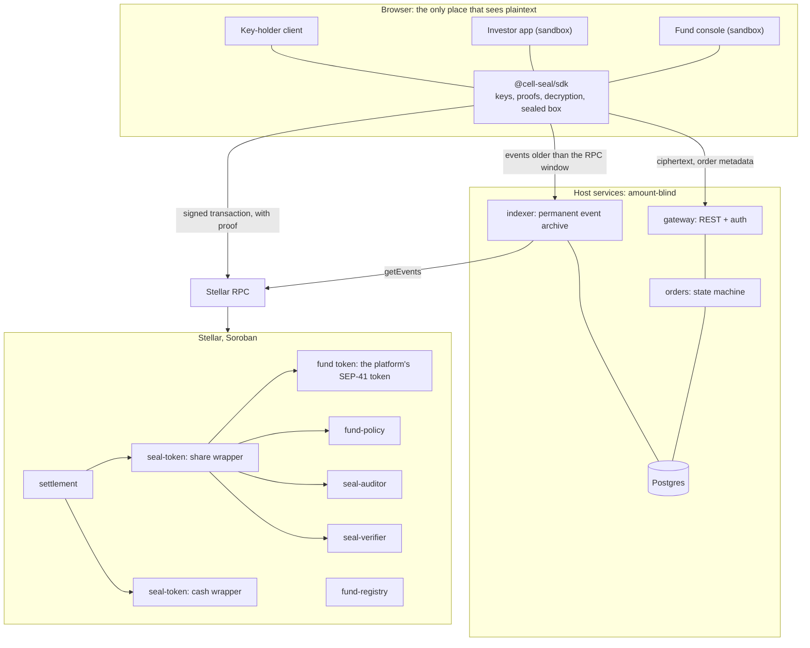
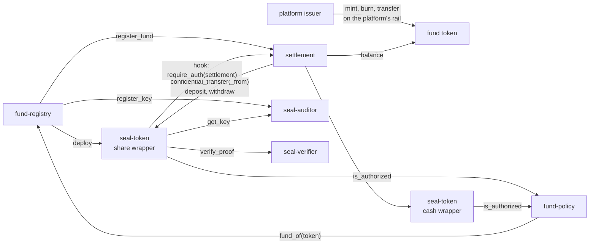
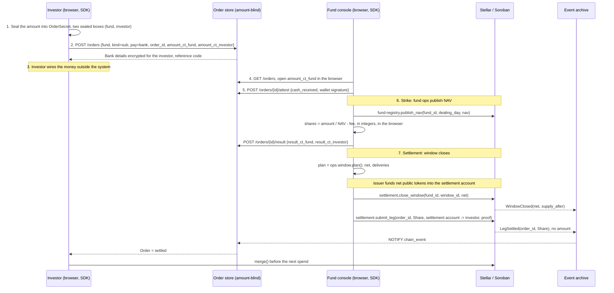

# Cell Seal: Technical Architecture Document

> The architecture document for the Stellar Community Fund (SCF) Build Award application. It
> follows the section order SCF reviewers expect: system overview, Stellar and Soroban integration,
> data flow, security, infrastructure, technology stack, open-source plan, status and path to
> mainnet. Every section ends with a pointer to the detailed design document that backs it.

| | |
|---|---|
| Project | **Cell Seal**: confidential settlement for tokenized fund shares on Stellar |
| Document | Technical Architecture Document, version 1 |
| Date | 2026-11-09 |
| Status | Architecture complete. Contracts and circuits exist as a testnet prototype that ran one full cycle with real proofs on 2026-10-09. SDK and sandbox apps: designed, not yet built |
| Track | SCF Build Award |
| Design repository | `SentinelLab-VN/Cell-Seal-TDD`, the full technical design, 15 documents, listed in section 9 |
| Prototype repository | `SentinelLab-VN/cell-seal-mvp`: six Soroban contracts, circuits, deploy and prove scripts, testnet run |
| Primitive | OpenZeppelin Confidential Token for Stellar, `stellar-contracts` branch `v0.9.0`, commit `5ffda91`, with Nethermind's `rs-soroban-ultrahonk` verifier |

Sections 1 to 6 are the architecture outline the SCF submission criteria ask for. Section 4.4
and 4.5 are the threat model and the monitoring plan of the Tranche 2 requirements. Section 7 is
the open-source plan for the contracts. Section 8 is what exists, what was measured, and what
stands between testnet and mainnet. Roadmap, tranche deliverables, budget and team are in the SCF
Build form, not here.

## 1. System overview

### 1.1 The problem and the product

A holder redeems a large position from a tokenized fund on Stellar. Five seconds later the ledger
records the wallet, the amount and the time: public, permanent, impossible to switch off. The
market front-runs the fund's asset sales, reprices the next raise, and other holders follow. The
law requires the issuer to know every holder, so identity cannot and should not be hidden. The
**amount** is the one field that can be sealed without touching that obligation.

Cell Seal is the settlement layer that seals it. Every transfer amount and every balance on the
public ledger becomes a Pedersen commitment carried by a zero-knowledge proof. Addresses,
timestamps and order references stay public. The issuer, the transfer agent and the regulator
hold a k-of-n viewing key and can rebuild 100% of the register. Cell Seal itself holds no key and
reads no amount.

It is sold to **tokenization platforms** on Stellar as a contract set plus a TypeScript SDK. The
platform keeps its fund token, its mint and burn rights, KYC, the order lifecycle and its own
apps. A fund joins the rail in one of two cases: a new fund with no token yet (Case 1), or a fund
with an existing token and public holders (Case 2).

| Property | Meaning |
|---|---|
| **Sealed** | Every amount on chain is a commitment, not a readable number. The market sees that a transaction happened, not how much |
| **Proven** | Every transaction carries an UltraHonk proof of conservation, range and policy. The chain rejects a wrong number without reading it |
| **Disclosed** | The viewing key is split k-of-n between issuer, transfer agent and regulator. They rebuild the full register. No Cell Seal endpoint ever returns an amount in plaintext |

### 1.2 Four design principles

| # | Principle | Technical consequence |
|---|---|---|
| P1 | **Cell Seal cannot read any amount** | Every amount leaves the browser as ciphertext. Encryption, decryption and proof generation happen only on the client, in a Web Worker. Every backend the SDK talks to is *amount-blind* |
| P2 | **The chain is the source of truth** | The status of an on-chain leg changes only when the event archive sees a final event. Every database is a read model, rebuildable from the chain and from ciphertext |
| P3 | **The rail knows nothing about fund business** | The contracts have no notion of NAV, cut-off or dealing day. Those live in the tokenization platform's system |
| P4 | **Compose, do not rewrite** | Commitments, circuits, verifier and freeze come from OpenZeppelin's Confidential Token. Cell Seal writes only what the primitive does not have |

### 1.3 System diagram

| Layer | Components | Where data lives | Who runs it |
|---|---|---|---|
| **Client** | The platform's own apps with `@cell-seal/sdk` embedded. In the sandbox: fund console, investor app, key-holder page | Private keys and plaintext amounts exist only here, in Web Worker memory. Encrypted openings in IndexedDB | The platform's users, in their browsers |
| **Soroban contracts** | `seal-token` wrapper (one per fund, one per stablecoin), `settlement`, `fund-policy`, `seal-verifier`, `seal-auditor`, `fund-registry` | Commitments, ciphertexts for recipient and auditor, order references, NAV, window nets, investor status. No plaintext amount other than the per-window `net` | The platform deploys one contract set from the audited wasm hashes |
| **Host services** | Stellar RPC, a permanent event archive, an order store for ciphertext | Events as raw XDR, order metadata, sealed boxes, signed attestations. No key, no amount | The platform, in its own infrastructure. The sandbox backend is a reference implementation |
| **External dependencies** | Stellar RPC, Freighter or another SEP-0053 capable wallet, a stablecoin (SAC) for on-chain cash legs, the platform's KYC source | | Third parties |

### 1.4 What is the product, what is the sandbox

| Layer | Form |
|---|---|
| Settlement contracts | **Product.** One contract set per platform, one wrapper per fund |
| `@cell-seal/sdk` | **Product.** Integrated into the platform's own apps and backend |
| Onboarding procedure, Case 1 and Case 2 | **Product.** Delivered with the SDK |
| Sandbox: backend (`gateway`, `orders`, `indexer`, `jobs`, Postgres), fund console, investor app | **Not the product.** A reference tokenization platform with the rail integrated, for evaluation and as a worked integration. Its `indexer` is the reference event archive a platform may run as is |

Detailed design: [`architecture.md`](architecture.md), [`overview.md`](overview.md),
[`integration.md`](integration.md).

## 2. Stellar and Soroban integration

### 2.1 Why Stellar

| Need | What Stellar provides |
|---|---|
| On-chain verification of UltraHonk proofs | BN254 and Poseidon host functions (Protocol 25 and 26). One proof verifies in 90 to 97 M instructions, well inside the 400 M transaction ceiling. Two proofs fit in one transaction |
| A confidential token primitive to compose with | OpenZeppelin's Confidential Token module for Soroban: commitments, six Noir circuits, auditor channel, freeze, policy hook |
| Tokenized funds that already exist on the chain | The fund token is any SEP-41 token: the SAC of a classic asset or a Soroban token. Cell Seal wraps it 1:1 without changing it |
| Atomic multi-contract invocations | One Soroban invocation calling two `confidential_transfer`s is atomic. This is what makes DvP possible without a new circuit |
| Deterministic wallet signatures | SEP-0053 message signing with ed25519 lets the privacy key be derived from the wallet. No separate seed phrase |
| Finality without reorgs | A ledger is final when it closes, so leg state can move on the first event |

### 2.2 The contracts

Repository `cell-seal-contracts` (today inside `cell-seal-mvp/contracts`). Rust, Soroban SDK, one
workspace crate per contract. The OpenZeppelin parts are pinned by commit.

| Contract | Instances | Purpose | Source |
|---|---|---|---|
| fund token | 1 per fund | The platform's SEP-41 token. The issuer mints and burns. Cell Seal has no rights on it | The platform's. A sample `share-token` ships for tests and Case 1 demos |
| `seal-token` | 1 per fund (share wrapper), 1 per stablecoin (cash wrapper) | Sealed balances and transfers. Implements the OpenZeppelin `ConfidentialToken`, `ConfidentialCompliance` and `ConfidentialClawback` traits. `SealHooks` enforce Cell Seal's rules | OpenZeppelin traits, concrete contract by Cell Seal |
| `seal-verifier` | 1 per platform | Verifies UltraHonk proofs. Holds one verification key per `CircuitType`, with a timelock on updates | Nethermind `rs-soroban-ultrahonk` + OpenZeppelin trait |
| `seal-auditor` | 1 per platform | Registry of viewing keys by `auditor_id`. One `auditor_id` per fund | OpenZeppelin `ConfidentialAuditor` trait |
| `fund-policy` | 1 per platform | `is_authorized(account, token)`: per-fund whitelist plus KYC expiry. Sees an address and a token, never an amount | Cell Seal |
| `settlement` | 1 per platform | The single gate for every sealed transfer. Attaches the order reference, executes DvP atomically, closes the settlement window by exactly `net`. Never mints or burns | Cell Seal |
| `fund-registry` | 1 per platform | Catalogue of funds and their public data: terms, NAV per dealing day, roles. Deploys the wrapper in `create_fund` | Cell Seal |

#### Key functions

| Contract | Function | Signer | What it does |
|---|---|---|---|
| `seal-token` | `register(account, auditor_id, data)` | account | Creates a sealed account. `on_register` forces the fund's `auditor_id` |
| `seal-token` | `deposit(from, to, amount)` / `withdraw(from, to, amount, data)` | from | Wrap in, unwrap out, public amount. Hooks restrict both: `from == to`, and `withdraw` on the share wrapper only by the settlement account via `settlement` |
| `seal-token` | `confidential_transfer(from, to, data)` / `confidential_transfer_from(spender, from, to, data)` | from / spender | Sealed transfer, proof in `data`. Hooks require the call to come from `settlement` |
| `seal-token` | `set_spender(account, spender, live_until_ledger, data)` / `revoke_spender` | account | Sealed allowance, escrowed from the spendable balance. Spender must be a settlement account |
| `settlement` | `submit_leg(fund_id, order_id, role, leg)` | leg.from | One sealed leg bound to `(order_id, role)`. Settles at most once |
| `settlement` | `settle_dvp(fund_id, order_id, pull, pay)` | settlement account | Atomic DvP between an investor and the fund: `confidential_transfer_from` then `confidential_transfer` in one invocation |
| `settlement` | `settle_pair(fund_id, order_id, a, b)` | both investors | Atomic secondary transfer, two authorization entries, one transaction |
| `settlement` | `close_window(fund_id, window_id, net, withdraw_data)` | issuer admin **and** settlement account | Refuses before `next_close`. `net > 0`: checks the settlement account holds `net` public tokens, then `deposit`. `net < 0`: `withdraw` with proof. Enforces the pilot cap. Emits `WindowClosed(net, supply_after)` |
| `fund-policy` | `is_authorized(account, token)` / `set_investor(fund_id, account, status, kyc_expiry)` | anyone / Compliance role | Whitelist and KYC check called for `from` and `to` on every operation |
| `fund-registry` | `create_fund(params, token, issuer_admin, settlement_account, auditor_key)` | issuer admin | One invocation: deploy the wrapper, register the auditor key, open window 1 in `settlement`, store `FundInfo` |
| `fund-registry` | `publish_nav(fund_id, dealing_day, nav)` | NavPublisher role | NAV on chain, one per dealing day, with a ledger anchor |
| `seal-verifier` | `verify_proof(circuit_type, public_inputs, proof)` / `update_verification_key` | any / platform admin | Verification. Key updates are two calls separated by `timelock_ledgers` (default 17280, about 24 hours) |

Full signatures, storage, events, error codes 4000 to 4505 and the permission matrix:
[`contracts.md`](contracts.md).

#### How contracts call each other

`settlement.require_auth()` inside the wrapper hook succeeds only when `settlement` is the
contract calling directly into `seal-token`. A direct call to the wrapper is rejected even when
the sender signed. Confirmed on testnet.

### 2.3 What lives on chain, what lives off chain, and why

| Data | On chain | Off chain | Why |
|---|---|---|---|
| Transfer amounts, balances | Pedersen commitment plus ciphertext for the recipient and for the auditor, in `seal-token` | The opening `(v, r)` in the holder's wallet, encrypted in IndexedDB | The chain must verify conservation without reading the number. The holder must be able to spend and recover |
| Order reference `order_id` | Yes, in `settlement` events, `SHA-256(fund_id ‖ investor ‖ nonce)` | Yes, the order store joins it to metadata | The only part of an order that appears publicly |
| Amount of a fiat order, payout, bank details | Never | Sealed box (X25519 + XSalsa20-Poly1305) to the fund's and the investor's box keys, in the order store | Fund ops must read it, the backend must not |
| NAV, dealing calendar, fund terms | `fund-registry` | Cached | Public by nature. Investors read the price from the chain. A ledger anchor for disputes |
| Window `net` and `supply_after` | `WindowClosed` event | Cached | The one aggregate figure per window that is public by design |
| Investor status, KYC expiry | `fund-policy` | The platform's KYC system | The wrapper checks policy on every transfer and must not depend on a backend being up |
| Order status, who placed what and when | No | Order store | Metadata the rail does not need. Changes only on final events or signed attestations |
| Event history | Stellar RPC keeps about 7 days | Permanent event archive | Wallets rebuild their openings by replaying events. Losing events destroys the ability to recover |
| Private keys, roots, viewing key shares | Never | Browser memory. Encrypted envelopes in the order store | P1 |

### 2.4 Standards and account model

| Topic | Choice |
|---|---|
| Token standard | SEP-41. The fund token may be a classic asset through its SAC or a Soroban token. Cell Seal calls `transfer` and `balance` only |
| Message signing | SEP-0053. The privacy key `sk` and the box key are derived from a wallet signature over a message that names the wrapper and the account. The SDK requests the signature twice and refuses non-deterministic signers |
| Asset flags | `AUTH_REQUIRED` is supported: the issuer authorizes the wrapper and the settlement account. `AUTH_CLAWBACK_ENABLED` requires a commitment not to claw back the wrapper's pool. SEP-8 regulated assets are a blocker for the sealed part |
| Custody | Non-custodial. The wrapper holds the pool backing every sealed balance. Investors hold their own Stellar key and privacy key. Cell Seal holds nothing |
| Accounts of a fund | Issuer admin (multisig), settlement account (a fund account whose signers are fund ops), fund ops personal accounts, key-holder accounts. Platform admin is a 2-of-3 multisig on hardware wallets with an on-chain timelock for upgrades |
| Settlement account's privacy key | Derived from a 32-byte `ops_root`, not from a signer, because the account has several operators. Two layers on spending: a proof needs `ops_root`, the transaction needs signer weight |

### 2.5 Resource usage, measured on testnet

Testnet protocol 29, `tx_max_instructions` = 400,000,000. Real UltraHonk proofs, real Nethermind
verifier, no mocks.

| Call | Proof | Instructions | Resource fee | Footprint ro / rw |
|---|---|---|---|---|
| `register` | register | 89,087,248 | 0.095 XLM | 11 / 1 |
| `close_window`, `net > 0` | none | 17,770,000 | 0.403 XLM, mostly rent for new entries | |
| `submit_leg` via `settlement` | transfer | 93,905,795 | 0.165 XLM | 17 / 3 |
| `close_window`, `net < 0` | withdraw | 96,637,602 | 0.129 XLM | 18 / 6 |
| Two transfer proofs in one transaction (`settle_dvp`, `settle_pair`) | 2 × transfer | about 188 M | | fits with room |

Proofs are 14,592 bytes regardless of circuit. Proving takes about 1 second per proof on a
laptop, 2.7 to 6.7 seconds multithreaded on a 4 GB phone. Shared conventions: amounts are `i128`
with 7 decimals, NAV is `i128` at scale `10^7`.

### 2.6 State archival and TTL

| Entry | Storage class | Strategy |
|---|---|---|
| `ConfidentialAccount`, `SpenderDelegation` in `seal-token` | Persistent | A host job (sandbox: `seal-jobs`) extends the TTL daily for every account active in the last 90 days. An expired entry can be restored at the restore fee. The platform pays and prices it into its service fee |
| `FundLink`, `WindowState`, `PilotCap`, `Settled(order_id, role)` in `settlement` | Persistent | Extended by the same job. `Settled` entries are the replay guard and must never expire silently |
| `fund-registry` storage, `fund-policy` entries | Persistent | Same job. A `Removed` investor entry stays, so account history is readable from chain |
| Verification keys in `seal-verifier` | Instance | Bumped with the contract instance |

Upgrades: `settlement`, `fund-policy` and `fund-registry` by the platform admin behind a timelock.
A fund's `seal-token` by that fund's issuer admin. The wrapper address is an input of every
investor's key derivation, so a wrapper is upgraded in place and never redeployed.

Detailed design: [`contracts.md`](contracts.md), [`primitives.md`](primitives.md),
[`cryptography.md`](cryptography.md).

## 3. Data flow

### 3.1 One order, two legs, two moments

Every subscription, redemption and secondary transfer is an order with a **share leg** (always
on chain, sealed) and a **cash leg** (fiat through a bank with an issuer attestation, or sealed
stablecoin on chain). Funds price forward, so the order is placed first, priced at **strike**
when NAV is published, and executed at **settlement** when the settlement window closes.

Two settlement modes: **DoP** (two legs apart, the default for subscriptions and redemptions with
the issuer) and **DvP** (both legs in one atomic transaction, mandatory for secondary transfers).

### 3.2 Happy path: subscription paid by bank transfer

| Step | Layer | What goes on chain | What the market sees |
|---|---|---|---|
| 1 to 2 | Client, order store | Nothing | Nothing |
| 3 to 5 | Bank, fund console, order store | Nothing. The attestation is a wallet-signed payload stored verbatim | Nothing |
| 6 | Fund console, `fund-registry` | NAV for the dealing day | The NAV, which the fund must publish anyway |
| 7 | Issuer, `settlement`, `seal-token` | One public funding of `net` into the settlement account, one `deposit` of `net`, N sealed transfers | One aggregate figure, and that N addresses received something |

### 3.3 Error handling at the critical points

| Failure | Detection | Resolution |
|---|---|---|
| Money never arrives | Order stays in `awaiting_cash`. Metric: age of the oldest order in that state | Fund ops hold, reject or cancel. No share ever moved |
| Attestation forged | The backend verifies the wallet signature and the `fund_ops:signer` role, which has its source of truth on chain | Rejected at write time. A compromised backend cannot forge it without a fund ops wallet |
| Window closed too early or without funding | `close_window` reverts with `4104 WindowNotDue` or `4108 NetNotFunded`. The SDK refuses earlier with `E_WINDOW_NOT_DUE`, `E_NET_NOT_FUNDED`, `E_NET_OVERFUNDED` | The issuer funds exactly `net` and retries. A surplus is refused because it leaks the next period |
| A delivery transaction fails mid-window | Proofs depend on each other through the settlement account's `C_spend`, so the SDK stops, resyncs and regenerates the remaining proofs | Every settled `(order_id, role)` is recorded, so a retry cannot double-deliver |
| Client reports "submitted" but the chain did not confirm | Leg state has no endpoint for clients. It changes only when the indexer sees `LegSettled` | The UI shows `confirming` until the archive has the event |
| Indexer falls behind the RPC retention window | Alert at 25% of the retention window consumed | Backfill from Horizon or an archive node. New orders with an on-chain leg are paused until caught up |
| Wallet state diverges from the chain | The SDK checks `v·G + r·H` against the on-chain commitment after every rebuild | `E_STATE_DIVERGED`: rebuild from the last checkpoint, block proving until it matches |
| On-chain verification key differs from the pinned one | `E_VK_MISMATCH` on `connect` | The SDK locks every proof-generating operation. The timelock on key updates buys reaction time |

### 3.4 The other flows in one line each

| Flow | Mechanism |
|---|---|
| Redemption, bank payout | The investor calls `submit_leg(investor → settlement account)` at order time. The settlement account is the recipient and decrypts the amount itself. After strike, fund ops pay and attest `cash_paid`. The shares are netted at `close_window` |
| Subscription or redemption in stablecoin (DvP) | At order time the investor `set_spender`s exactly the needed part to the settlement account. At settlement, `settle_dvp` pulls one leg and pays the other in one invocation. The investor need not be online |
| Secondary transfer (DvP) | Each side builds the proof for its own leg, decrypts the leg it receives to check the agreed amount, then signs one authorization entry. `settle_pair` executes both. The receiver sends the opening to the fund so the register updates without the viewing key |
| Disclosure | A disclosure request with scope and expiry. `k_t` key holders each compute a partial decryption with a DLEQ proof. The reader combines them per event and checks every opening against the on-chain commitment. Every unlock is logged |

Detailed design: [`flows.md`](flows.md), [`architecture.md`](architecture.md) section 8,
[`backend.md`](backend.md) section 5, [`sdk.md`](sdk.md).

## 4. Security

### 4.1 Key management

| Key | Algorithm | Where it lives | How it is derived and recovered |
|---|---|---|---|
| Stellar key | ed25519 | The user's wallet (Freighter or any SEP-0053 wallet). Platform admin on hardware wallets, 2-of-3 | The wallet's own backup |
| Privacy key `sk`, `vk` | Grumpkin | Web Worker memory only. Zeroed after 15 minutes of inactivity. Never reaches the main thread | Derived from a SEP-0053 signature over a message naming the wrapper and the account, through HKDF-SHA-512 with rejection sampling. Re-derived every session. Signature checked against the expected public key. Non-deterministic wallets get a 32-byte raw root with a mandatory backup |
| Ops root of a fund | 32 random bytes | Browser of the `signer` fund ops. Distributed as sealed envelopes | Generated once at fund creation. Root of the settlement account's privacy keys and of the fund's box key. Exposure allows reading, not moving |
| Box key | X25519 | Derived per session for users. For a fund, from `ops_root` | Sealed boxes for off-chain order data, fully separate from the primitive's cryptography |
| Viewing key share `k_j` | Grumpkin scalar | Key-holder client memory. One sealed backup envelope | Pedersen-style DKG at fund creation, default 2 of 3 (issuer, transfer agent, regulator). The full key `k` never exists in one place, except in the clawback ceremony |
| Platform admin key | ed25519 multisig | Hardware wallets | Every upgrade and verification-key change goes through an on-chain timelock |
| Session token | JWT, 15 minutes | Browser | Wallet-signed challenge. Carries no key and no amount |

No backend ever holds a private key, a root or a plaintext amount. Full inventory, rotation and
loss handling: [`keys.md`](keys.md).

### 4.2 Access control

| Operation | Platform admin | Issuer admin | Settlement account | Fund ops | Investor |
|---|---|---|---|---|---|
| Deploy, upgrade platform contracts | yes, multisig + timelock | | | | |
| Write verification keys | yes, timelock | | | | |
| `create_fund`, `update_terms`, `grant_role`, `revoke_role` | | yes | | | |
| `set_pilot_cap` | yes | | | | |
| `rotate_key` for the fund | | yes | | | |
| `freeze`, `clawback` | | yes | | | |
| `close_window` | | co-signs | co-signs | | |
| Mint, burn the fund token | | yes, on the platform's rail, outside Cell Seal | | | |
| `settle_dvp`, deliver subscription shares | | | yes | operator | |
| `set_investor`, `publish_nav` | | | | yes, by on-chain role | |
| `register`, `submit_leg`, `set_spender`, `revoke_spender`, `merge` | | | | | yes |
| `settle_pair` | | | | | yes, both sides |

Admin operations are restricted by `require_auth` on the admin address plus role checks in
`fund-registry.has_role`. Fund roles have their source of truth on chain; the backend only caches
them and revokes API access as soon as the indexer sees `RoleRevoked`.

### 4.3 Input validation

| Surface | Validation |
|---|---|
| Proofs | Verified on chain by `seal-verifier` against a pinned verification key. The circuits enforce range (`v < 2^127`), conservation, and binding to the sender's current `C_spend`, so a replayed proof is void |
| Leg shapes in `settlement` | `4103 LegShapeInvalid` covers every rule: direction, token membership in the fund, settlement account where required, two different tokens for DvP. `(order_id, role)` settles at most once |
| Hooks in `seal-token` | `on_register` enforces the fund's `auditor_id`. `on_deposit` requires `from == to` and policy. `on_withdraw` allows only the settlement account via `settlement`. `on_transfer` requires the call to come from `settlement`. `on_set_spender` allows only a settlement account as spender |
| Policy | `is_authorized` runs for `from` and `to` on every operation. `Suspended` or `Removed` fails at once |
| Sealed boxes | The backend checks length and format only. The client checks that the `order_id` inside the plaintext matches the order (`E_BOX_OPEN_FAILED` otherwise). Numeric fields are padded to a fixed length so ciphertext size reveals nothing |
| Amounts in the apps | `bigint` at scale `10^7` throughout, never floating point. Decimal input parsed with at most 7 places. Rounding down, one rule, matching the future price-linking circuit |
| Backend API | `Idempotency-Key` on every write. No numeric column with a monetary meaning except public NAV and `net`. CI scans the schema and logs to keep it that way |

### 4.4 Threat model

What must be protected: A1 confidentiality of amounts, A2 integrity of shares, A3 the fund's and
the regulator's ability to read, A4 the investor's ability to spend, A5 metadata.

| Adversary | Capability | Outcome against Cell Seal |
|---|---|---|
| Chain observer | Reads every public byte, forever, with analysis tooling | Sees who the investors are, how often each address transacts, NAV, the weekly `net`. Does not see any order size or any balance. Residual risk: thin windows (L6), top-ups sized like orders (L9) |
| Malicious investor | A valid account, arbitrary proofs | Overspend, negative amount and replay are rejected by the circuits and by `C_spend` binding. Withholding the opening after a secondary transfer only delays the register until reconciliation |
| Backend attacker | Full read and write on the order store and archive | Gets metadata and ciphertext, no amount, no key. Cannot change on-chain leg state. Cannot forge an attestation. A swapped `box_pk` is caught because the client verifies the wallet signature on it and the fund's `box_pk` is anchored in `fund-registry` |
| Cell Seal insider | Release rights on the SDK and the wasm | Planting key-stealing code in a web build is **the largest remaining risk of the web model**. Mitigations: reproducible builds, published hashes, the platform building from source, strict CSP, no third-party scripts |
| Malicious fund ops | The `signer` role of one fund | Can read that fund's orders. Cannot move assets without the settlement account's signer weight. Cannot pull an allowance without paying (`settle_dvp` demands both legs). Wrong amounts are detectable from openings and the audit log |
| Malicious key holder | One share | Harmless below threshold. Collusion to the threshold reads everything in that key epoch: the chosen trust model, hence shares sit with independent legal entities |
| Upstream third party | A bug in the circuits, the verifier or the primitive | Could break A1 or A2. Handled by the pilot cap and the audit conditions in section 4.6 |

**Known attack vectors specific to this design.** Reentrancy does not apply: Soroban has no
reentrancy. Oracle manipulation: NAV is published by the fund under an on-chain role, and the
chain does not enforce the price relation in the first release, so a wrong NAV is detectable
from the investor's decrypted leg and from the ledger anchor, not prevented. Flash loans: no
pooled liquidity exists. Pooled custody: the wrapper holds the pool for every holder, so a SAC
issuer that claws back the wrapper address affects everyone; the onboarding checklist requires a
no-clawback commitment for the fund token and a stated policy for stablecoins.

**Leak catalogue.** 18 ways an amount could be inferred from public data, each with its blocking
point: for example a payout in a public stablecoin (`payout / NAV = shares`, blocked by requiring
the on-chain cash leg to be sealed), an unwrap right after a large order (blocked by `close_window`
refusing before `next_close`), a window with one order (shown as a privacy indicator before
closing, longer windows per fund), ciphertext length (fixed-length padding). Master list L1 to
L18: [`security.md`](security.md) section 3.

**System invariants** S1 to S7 and on-chain invariants T1, T2, C1 to C6, with what enforces each:
[`security.md`](security.md) section 4, [`contracts.md`](contracts.md) section 9.

### 4.5 Monitoring plan

The on-chain events and metrics below are the observability surface that Tranche 2 is expected
to deliver. Every event listed is already emitted by the contracts in the prototype.

| Signal | Source | Threshold | Response |
|---|---|---|---|
| `WindowClosed(net, supply_after)` vs `balance(token, wrapper)` | Indexer reconciliation after every close (T1a) | Any mismatch | Highest severity. Freeze `close_window`, reconcile, notify the fund |
| Wrapper `Deposit` / `Withdraw` outside `close_window` that is not a holder self-wrap (T1b) | Indexer | Any | Highest severity. Investigate the wrapper admin key |
| Issuer funding not equal to `net` before a close, or recall not equal to `|net|` after (T1c) | Indexer reads the fund token's `transfer`, `mint`, `burn` events | Any drift | Highest severity. Supply discipline broken |
| Self-wrap `Deposit` right after a public `transfer` from the issuer to the same address (L15) | Indexer | Any | Warn the platform: a public amount tied to an address |
| Verification key proposal or update in `seal-verifier` | Contract events | Any outside the planned release calendar | SDK blocks proving by itself. Investigate the platform admin key during the timelock |
| `rotate_key`, `freeze`, `clawback`, `RoleGranted`, `RoleRevoked` | Contract events | Every occurrence | Logged to the audit log. Compliance to-do |
| Indexer lag | `GET /status` vs latest ledger | Above 25% of the RPC retention window | Alert, backfill path. Pause new orders with an on-chain leg |
| Window past `closes_at` and not closed | Backend scheduler | Any | Remind fund ops. Investors see the delay |
| Age of the oldest order in `awaiting_cash` | Backend | Per fund policy | Fund ops follow up |
| Error rate by code (`4xxx` on chain, `E_*` in the SDK, API errors) | Backend logs, SDK telemetry without amounts | Spike | Investigate |
| Proving time per device class | Measured before every release | Regression against the baseline in section 2.5 | Block the release |
| Any numeric field resembling an amount in a request body, URL, header or log | End-to-end network scan, log scan in CI | Any | Build fails |

### 4.6 Audit plan

| Stage | Activity |
|---|---|
| Foundation (Tranche 1) | Upstream test vectors pass. Real proofs on the `local` network in CI. Schema and log scanning for S1. Mock verifiers are forbidden from integration tests upward |
| Settlement complete (Tranche 2) | Fuzz `settlement`: leg shapes, repeated `order_id`, call order, early `close_window`. Property tests for T1, T2, C1 to C6. End-to-end network scan for amount leaks. Threat model and monitoring plan delivered as above |
| Before mainnet (Tranche 3) | Independent cryptographic review of the six items Cell Seal designed itself (R1 sealed box, R2 DvP protocol, R3 DKG and threshold decryption, R4 clawback ceremony, R5 register openings, R6 key derivation). External audit of `settlement`, `fund-policy`, `fund-registry` and `SealHooks`. The intention is to apply to the **Stellar Audit Bank** for this audit. Rehearsal of the clawback ceremony and of an `ops_root` compromise on testnet |
| Mainnet pilot | Per-fund supply cap in `settlement`. The cap is lifted only when the verifier is audited, the non-zk flavour question has an answer, and the Cell Seal contracts are audited |

Incident response for the six incident classes (suspected soundness bug, `ops_root` compromise,
backend compromise, tampered web build, lost events, unplanned verification key change):
[`security.md`](security.md) section 8.

Detailed design: [`security.md`](security.md), [`keys.md`](keys.md),
[`cryptography.md`](cryptography.md) section 10.

## 5. Infrastructure and deployment

### 5.1 Hosting

| Component | Where it runs | Notes |
|---|---|---|
| Contracts | Stellar. One contract set per platform, deployed by the platform from the audited wasm hashes with its own admin key | Cell Seal publishes releases and hashes, operates nothing for real funds |
| SDK | Inside the platform's apps, from the package registry | Pinned circuit artifacts (ACIR, verification key) compared against `seal-verifier` at startup |
| Host services (event archive, order store) | The platform's own infrastructure | The sandbox `indexer` is a reference implementation a platform may run as is |
| Sandbox | Docker Compose: `gateway`, `indexer`, `jobs`, Postgres 16, fund console, investor app. Cell Seal hosts one instance on testnet for evaluation. A platform can run its own copy from source | The investor app and the fund console are two origins. The console can sit behind a private network |
| Web apps | Static builds behind a CDN with `COOP: same-origin`, `COEP: require-corp` for multithreaded proving, strict CSP, no third-party scripts, self-hosted error reporter that strips numbers | Bundle hash published with every release |

### 5.2 RPC strategy

| Environment | Endpoint | Rationale |
|---|---|---|
| `local` | Quickstart container, real verifier, real proofs | Development and CI |
| `testnet` | Public SDF RPC for development. A dedicated RPC provider for the hosted sandbox | The indexer must never fall behind the retention window |
| Mainnet pilot and production | Dedicated RPC from a provider, with a second provider as failover, operated by the platform. Horizon or an archive node as the backfill path for the event archive | Event retention on RPC is about 7 days. The archive is the durable store |

The SDK takes one URL per host service and stitches the RPC event tail with the archive at the
seam, so the apps never depend on RPC retention.

### 5.3 Monitoring and alerting

Structured JSON logs with `_ct` fields never written. Metrics: indexer lag in ledgers, orders by
status, age of the oldest `awaiting_cash` order, attestations per day, error rate by code.
Alerts: indexer lag over threshold, supply reconciliation mismatch, window past `closes_at` and
not closed, verification key changed on chain. Backup: Postgres point-in-time recovery for the
data that cannot be rebuilt from chain (ciphertext, attestations, envelopes, audit log). Full
plan: section 4.5 and [`backend.md`](backend.md) section 8.

### 5.4 Deployment plan: testnet first, then mainnet

| Environment | Stellar network | Purpose | Gate |
|---|---|---|---|
| `local` | Quickstart | Every commit. Real proofs | CI green, no mock verifier |
| `testnet` | Testnet | Integration, hosted sandbox, pilot with a sample fund. One full window with at least three subscriptions and two redemptions; only `net` appears as a public figure; the register rebuilt in the browser equals `balance(wrapper)` | Verification checklist in [`onboarding.md`](onboarding.md) section 7 |
| `mainnet-pilot` | Mainnet | Capped pilot. The value cap is configured per fund in `settlement` and refused on `close_window` when exceeded | Confidential Token available on mainnet. Contract audit complete. Cryptographic review complete |
| Mainnet | Mainnet | Cap lifted by `set_pilot_cap` | Verifier audited. Non-zk flavour question answered upstream |

Rollback: contracts upgrade in place behind a timelock, so a bad release is withdrawn during the
timelock. A tampered web build is pulled and the hash-verified build restored. Per-fund
operations can be stopped by freezing accounts and halting `close_window`.

Detailed design: [`architecture.md`](architecture.md) section 9, [`backend.md`](backend.md)
section 8, [`frontend.md`](frontend.md) section 8.

## 6. Technology stack

| Layer | Technology | Notes |
|---|---|---|
| Smart contracts | Rust, Soroban SDK, `wasm32v1-none`. OpenZeppelin `stellar-contracts` `v0.9.0` pinned by commit. Nethermind `rs-soroban-ultrahonk` verifier | One workspace crate per contract |
| Zero-knowledge circuits | Noir, UltraHonk, Aztec Ignition SRS. `nargo 1.0.0-beta.11`, `bb 0.87.0`. Six upstream circuits used unmodified | The six verification keys rebuild byte-identical with the locked toolset |
| Cryptography in the SDK | Grumpkin curve, Pedersen commitments, Poseidon2, ECDH one-time pad (primitive). X25519 + XSalsa20-Poly1305 sealed boxes (libsodium `crypto_box_seal`). Pedersen DKG, Chaum-Pedersen DLEQ, Lagrange combination (threshold viewing key) | Everything Cell Seal designed itself is in scope for the independent review |
| SDK | TypeScript, `@cell-seal/sdk`. bb.js (WASM) in a Web Worker. Layers: `core`, `keys`, `prover`, `wallet`, `token` (upstream spec), `box`, `threshold`, `seal`, `rpc` (Cell Seal) | Keys never leave the worker |
| Frontend (sandbox) | Vite, React 19, TypeScript, Tailwind 4, TanStack Query, Freighter. `@cell-seal/ui` design system. Vitest, Testing Library, Playwright | Two apps, two origins. Decrypted data in memory only |
| Backend (sandbox) | Rust: axum 0.8, sqlx 0.8, tokio. Postgres 16. Crates `gateway`, `auth`, `orders`, `indexer`, `jobs`, `core` | Amount-blind by schema. `indexer` is the reference event archive |
| Wallet and auth | Freighter or any SEP-0053 wallet. Wallet-signed challenge, JWT sessions of 15 minutes | No passwords, no email identifiers |
| RPC and data | Stellar RPC (`getEvents`, `getTransaction`, simulation). Horizon or archive node for backfill | Permanent event archive in Postgres |
| Testing | `cargo test`, `proptest`, `cargo-fuzz` for contracts. Real proofs against the real verifier on the `local` network. Schema, log and network scans for amount leaks | No mock verifier above unit level |
| Deployment | Docker Compose for the sandbox. `stellar` CLI 27.1 for contract deployment. Static hosting with COOP, COEP and CSP for the apps | |
| Design | Pen (`design/cell-seal.pen`), 18 exported screens | |

## 7. Open-source plan

| Component | Plan | License |
|---|---|---|
| Smart contracts: `seal-token`, `settlement`, `fund-policy`, `seal-verifier`, `seal-auditor`, `fund-registry`, the sample `share-token` | Source published in a public repository. Every release ships the wasm hashes that the platform deploys, so anyone can reproduce the build and compare | Open-source license to be confirmed by the team before submission. Apache-2.0 is the working assumption, matching the SDK |
| Circuits | The six upstream Noir circuits are used unmodified and are already open source (OpenZeppelin, MIT). Cell Seal's witness helpers and verification-key build recipe are published with the contracts | Same as the contracts |
| `@cell-seal/sdk`, layers `core`, `keys`, `prover`, `wallet`, `token` | The implementation of the upstream SDK spec. Usable by any wallet or tool built on the Confidential Token, independent of Cell Seal. Published first, as the public-good part | Apache-2.0 |
| `@cell-seal/sdk`, layers `box`, `threshold`, `seal` | Published once the settlement contract and the threshold protocol are stable | Apache-2.0 |
| Sandbox: backend, fund console, investor app | Published as the reference integration. A platform may run it from source | Open-source license to be confirmed by the team |
| This design | The 15 documents in this repository, published at `docs.cellprivate.com/seal` | |

OpenZeppelin ships a spec for a Confidential Token SDK but no SDK, and no durable indexer. The
`core` to `token` layers and the reference `indexer` fill that gap for every project built on the
primitive.

## 8. Status, evidence and the path to mainnet

### 8.1 What exists today

| Part | Status |
|---|---|
| Technical design | Version 1, 15 documents, the basis for implementation. Product model decided 2026-10-24: contracts plus SDK sold to platforms, `settlement` neither mints nor burns |
| Contracts | Six Soroban contracts plus the sample token exist as a testnet prototype. Six changes against the product decision are listed in [`integration.md`](integration.md) section 8 and are the first implementation work |
| Circuits and verifier | Upstream circuits compiled, verification keys reproduced byte-identical, Nethermind verifier deployed on testnet |
| Testnet run | One full cycle on 2026-10-09 with real proofs: register, `close_window(net = +1,000)`, `set_investor`, investor `register`, sealed delivery of 250 shares, sealed redemption of 100 shares with `order_id`, `close_window(net = −100)` with a withdraw proof. The ledger shows two sealed transfers and two public numbers, never 250 or 100 |
| Measurements | Section 2.5. The design rests on these figures |
| SDK | Designed ([`sdk.md`](sdk.md)). Not started |
| Sandbox backend and apps | Designed ([`backend.md`](backend.md), [`frontend.md`](frontend.md)), 18 screens drawn. Not started |

Prototype addresses on testnet (second deployment, fund id 1, auditor id 1):

| Contract | Address |
|---|---|
| `seal-verifier` | `CA2PXTXTHFLCE7BXVT57DW5W4WJQAWSGDCYPEKSTIQ5UCMHVCUQUFS4P` |
| `seal-auditor` | `CCCARBMFWGVMSICUWPWG2EPXOPPW557ZOZYZSI56NUAIMR5XI56PXYFT` |
| `settlement` | `CDQYBGOIQADD7H6AR5KIIOFYJGCPOGUJJMC47QT5ES3X6BB6DM5BIWET` |
| `fund-policy` | `CAKWWMNHTCNRP2YJVMEA2THFW6LNA34O7XD3POWLHST4CJ2ADAB655DN` |
| sample `share-token` | `CAX6PWTLDIFLS7O2C7YSSLG2Q7NM6IND5CZHGIZDHYY3W3NOOFTUUOTW` |
| share wrapper (`seal-token`) | `CDIRPEVPIX5LXWV7HYRVXTE3LZ244L7SMA7NZXYZV26CE6WYMCJ63IAN` |

### 8.2 What Cell Seal builds, what it reuses

| Reused from the primitive | Cell Seal builds |
|---|---|
| 1:1 wrapper, sealed transfer, spender and allowance, freeze, auditor registry, holder key model, six circuits, on-chain verifier | Two-leg order model and DoP mode. Confidential DvP as a settlement contract, no new circuit. Settlement window with on-chain schedule. `fund-policy` whitelist plus KYC. k-of-n viewing key by off-chain threshold ECDH. Sealed box for off-chain amounts. Register reconstruction. The client SDK. The reference indexer. The sandbox |

### 8.3 Dependencies outside Cell Seal's control

| Dependency | Status | Impact | Handling |
|---|---|---|---|
| Confidential Token module on mainnet | Developer preview on testnet. One audit round done, report not published. Not in a stable release | Mainnet go-live waits for it. Everything Cell Seal builds can be completed on testnet before | Pin the commit, track `v0.9.0`, rerun compatibility tests on every upgrade |
| Verifier `rs-soroban-ultrahonk` | Not audited | A soundness bug would allow forged proofs | Condition for lifting the pilot cap |
| Non-zk proof flavour | The upstream recipe does not enable `--zk`; the verifier implements only the non-zk flavour | A proof may leak information about the witness | Raised with upstream. Condition for lifting the pilot cap |
| Wallet message signing | SEP-0053 support is uneven; MPC wallets sign non-deterministically | The signer root cannot be derived | Determinism check at enrolment, raw-root fallback with mandatory backup |
| Stellar RPC retention | About 7 days of events | A lagging indexer loses events for good | Alerting at 25%, backfill path, permanent archive |

### 8.4 Known limits of the first release

The chain does not enforce the price relation between the two legs of a DvP order; the investor
checks afterwards from the decrypted leg, and a price-linking circuit with its own verifier comes
later. The position limit is checked at order intake off chain, not by a circuit. Clawback uses
the primitive's public-amount clawback through a controlled key-reconstruction ceremony; a sealed
forced transfer comes later. Wrapping in and unwrapping out reveal the amount, which is why
redemptions never unwrap and the window publishes only `net`. Fiat is confirmed manually by fund
ops in the first version.

## 9. Document map

| # | Document | Scope | Answers |
|---|---|---|---|
| 0 | This document | Both | The architecture outline for SCF reviewers |
| 1 | [`overview.md`](overview.md) | Both | What the product does, for whom, what it does not do |
| 2 | [`glossary.md`](glossary.md) | Both | What each term means, and where it appears in the contracts and the SDK |
| 3 | [`flows.md`](flows.md) | Product | Each business flow: who does what, what goes on chain, what the market sees |
| 4 | [`integration.md`](integration.md) | Product | What the platform owns, what Cell Seal provides. Fund token conditions. Who mints, who burns. Reconciliation |
| 5 | [`onboarding.md`](onboarding.md) | Product | Bringing a fund onto the rail: Case 1 and Case 2, step by step, verification before go-live |
| 6 | [`primitives.md`](primitives.md) | Product | The OpenZeppelin Confidential Token: what is reused, what is built, what was measured |
| 7 | [`architecture.md`](architecture.md) | Both | Components, trust boundaries, data classification, data flows, deployment |
| 8 | [`contracts.md`](contracts.md) | Product | Each contract: functions, events, errors, permissions, invariants |
| 9 | [`cryptography.md`](cryptography.md) | Product | Anatomy of a transfer, sealed box, DvP, threshold viewing key, openings, review scope |
| 10 | [`keys.md`](keys.md) | Product | Every key: generation, storage, recovery, rotation, loss |
| 11 | [`sdk.md`](sdk.md) | Product | The `@cell-seal/sdk` API and the host services it needs |
| 12 | [`security.md`](security.md) | Both | Threat model, leak catalogue, invariants, assurance plan, incident response, test strategy |
| 13 | [`backend.md`](backend.md) | Sandbox | Services, API, state machine, reference indexer, data model, operations |
| 14 | [`frontend.md`](frontend.md) | Sandbox | Routes, data handling, amounts, browser security |
| 15 | [`design/`](design/README.md) | Sandbox | The 18 screens of the fund console and the investor app |

Conventions: English throughout. **L-n** is an amount leak path, **R-n** an item in the scope of
the cryptographic review. Stellar accounts are `G...`, contracts are `C...`. Amounts in prose are
illustrative; the only public figure the design produces per window is `net`.
